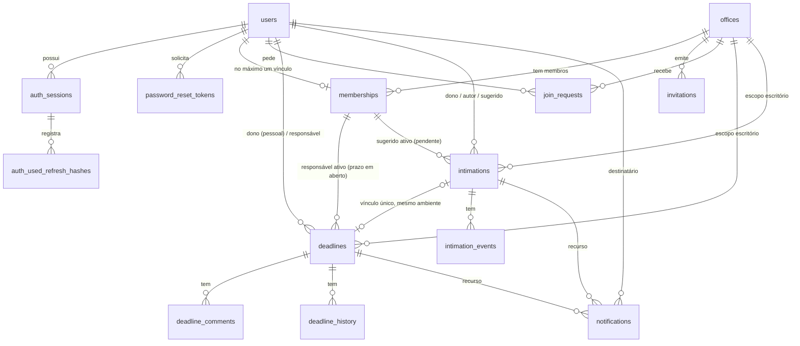

# 15 — Projeto técnico: persistência em PostgreSQL

> **Documento de projeto. Nada aqui foi implementado.** Não há ORM, migrations, dependências
> novas nem mudança de comportamento na aplicação. A implementação só começa após a aprovação das
> decisões da §12.
>
> **Base analisada:** `main` em `d0e182eb0d8bc9ee14e925d97cb9db1ef2fdb9d1` (merge do PR #17,
> Etapa 6.4). **CI pós-merge** (execução por push nesse commit): `frontend`, `backend`,
> "Verificar estrutura" e `integration` (integração real + E2E) com todos os passos em `success`.
> Nenhum bloqueio.
>
> **Arquivos complementares:** `15a-ddl-proposto-postgresql.sql` (rascunho do esquema, não é
> migration), `15b-cenarios-ddl-proposto.sql` (cenários autoverificáveis e reproduzíveis) e
> `15c-cenarios-saida-esperada.txt` (saída esperada), descritos na §11.
>
> **Revisão 2** (sobre `965ab64`): protocolo SQL completo de autenticação (§4.3), consistência das
> leituras (§4.5), relógio pós-lock (§4.6), modos por entrega e bloqueio de produção (§5.6),
> proteções da fixture de testes (§5.7), manutenção na matriz de bloqueios e política completa da
> caixa (§4.2, §5.4), correção sobre a dupla confirmação (§4.4), nova tentativa segura do código de
> ingresso (§4.4) e cenários reproduzíveis (§11).

---

## 1. Fechamento do núcleo funcional

| Funcionalidade | Situação | Observação |
|---|---|---|
| Cadastro, login, sessão, perfil, logout | **Implementado e integrado** | sessão opaca no BFF; tokens só no servidor |
| Escritório, equipe, permissões, convites, solicitações | **Implementado e integrado** | |
| Prazos, calendário, comentários, histórico, transferência | **Implementado e integrado** | vencimento informado pelo usuário (não é cálculo oficial) |
| Intimações (metadados), revisão humana, confirmação, descarte | **Implementado e integrado** | sem arquivo, sem processamento |
| Notificações internas de atribuição | **Implementado e integrado** | não são lembretes de vencimento |
| Recuperação de senha (`forgot`/`reset`) | **Somente no backend** | entrega `NoopPasswordResetDelivery`: nenhum e-mail é enviado; telas `/esqueci-senha` e `/redefinir-senha` mostram "indisponível" |
| `retry` de intimação, pontos de processamento | **Somente no backend** | sem processamento real; rota fora da allowlist do BFF |
| Cálculo legado de prazos e feriados (Etapa 1) | **Somente no backend** | as telas integradas não o usam |
| **Todo o estado do domínio e da autenticação** | **Pendente para o banco** | tudo em memória: perde-se ao reiniciar; um processo só |
| **Dashboard** | **Pendente para o banco** | só existe o protótipo demo; a integração depende de consultas agregadas, mais simples com SQL; não está concluído |
| Retenção e expurgo periódicos | **Pendente para o banco** | hoje são varreduras dentro das transações em memória |
| **Envio de e-mail** (recuperação de senha, convites) | **Pendente para serviços externos** | provedor SMTP/transacional |
| **Armazenamento de PDFs** | **Pendente para serviços externos** | armazenamento de objetos; hoje `file.storage = "not_stored"` |
| **IA/OCR** | **Pendente para serviços externos** | `processing.status = "not_available"` |
| **Sessões do BFF** | **Pendente para produção** | `Map` em memória no processo Node; perde-se ao reiniciar; incompatível com várias instâncias |
| **Limites por processo** (rate limiting) | **Pendente para produção** | `RateLimiter` em memória no backend; com várias instâncias, cada uma conta separado |
| CSP, cookies `__Host-`, HTTPS, segredos, backups, monitoramento, implantação | **Pendente para produção** | a CSP estava prevista para a 6.5 |

---

## 2. Mapeamento do código atual

### 2.1 Interfaces e implementações
| Domínio | Interface (Protocol) | Implementação em memória | Usado por |
|---|---|---|---|
| Usuários e credenciais | `repositories/auth.py: UserRepository` | `repositories/memory.py: InMemoryUserRepository` | `AuthService`, `OrgService` (nomes) |
| Sessões e rotação de refresh | `SessionRepository` (+ `RotationResult`) | `InMemorySessionRepository` | `AuthService.login/refresh/logout` |
| Recuperação de senha | `PasswordResetRepository` | `InMemoryPasswordResetRepository` | `AuthService.forgot/reset` |
| Escritórios, vínculos, convites, solicitações | `repositories/org.py: OrgTransaction`, `OrgRepository` | `repositories/org_memory.py: MemoryOrgStore/MemoryOrgTransaction` | `OrgService` |
| Prazos, comentários, históricos | `repositories/deadlines.py: DeadlineTransaction` | `repositories/deadlines_memory.py` | `DeadlineService`, `deadline_ops.py` |
| Intimações, vínculo, eventos | `repositories/intimations.py: IntimationTransaction` | `repositories/intimations_memory.py` | `IntimationService` |
| Notificações e deduplicação | `NotificationTransaction` (`add` → `False` se duplicada) | `MemoryNotificationTransaction` (chave `destinatário|evento`) | `NotificationService`, `deadline_ops.notify` |
| Transação entre módulos | `repositories/deadlines.py: UnitTransaction` | `repositories/unit_of_work.py: MemoryUnitOfWork` | todos os serviços de domínio |
| Composição | — | `services/auth_container.py`, `services/org_container.py`, `main.py` | criação da app |

### 2.2 Dependências concretas de memória (por que não basta trocar um repositório)
1. **Serviços tipados com a classe concreta:** `DeadlineService`, `IntimationService` e
   `NotificationService` recebem `unit_of_work: MemoryUnitOfWork`. `OrgService` recebe o mesmo
   objeto duas vezes (`repo=uow, unit_of_work=uow`).
2. **Exceção importada do módulo em memória:** `CapacityError` vem de `deadlines_memory.py`
   (usada nos serviços de prazos e intimações).
3. **Locks globais de processo:** `MemoryUnitOfWork.unit()` adquire, em ordem fixa, os locks de
   escritórios, prazos, intimações e notificações. Isso **serializa todas as operações de domínio
   de todos os escritórios**. A troca exige bloqueios por linha (§4).
4. **Invariantes verificados em Python no fim da transação:** `_check_responsibles` e
   `_check_intimations` percorrem os registros tocados (`touched`, `removed_memberships`). No
   PostgreSQL, parte vira restrição e parte vira consulta de verificação (§3.3).
5. **Atomicidade da autenticação por um único `RLock`:** `complete_reset` altera token, usuário e
   sessões de uma vez, por estarem no mesmo `MemoryAuthStore`. No banco, os três repositórios
   precisarão compartilhar **a mesma transação**.
6. **Autenticação e domínio em armazenamentos separados:** `OrgService` lê nomes pelo
   `UserRepository` de outro store. No banco, ficam juntos e permitem junções.
7. **Consultas feitas em memória:** listagens carregam o escopo inteiro (`in_scope`,
   `of_recipient`, `members_of`…) e filtram, ordenam e paginam em Python. No banco, as interfaces
   precisam de métodos de consulta com filtro, ordem e paginação em SQL, com a autorização aplicada
   na consulta.
8. **Limites de capacidade contados em memória:** `validate_capacity` e a política da caixa de
   notificações (`enforce_capacity`) precisam de contagem sob bloqueio.
9. **Expurgo dentro da transação:** `maybe_purge` (convites e solicitações encerrados, intimações
   descartadas, notificações lidas) roda no início das transações.
10. **Relógio lido depois dos locks** (`tx.now`). No banco, o instante é capturado por transação
    depois de obter os bloqueios-âncora; o relógio continua injetável nos testes.
11. **Injeção de falhas:** `fault`/`checkpoint` (5 arquivos de teste). Continua possível: lançar
    uma exceção num checkpoint resulta em `ROLLBACK`.
12. **Configuração e bloqueios:** `AUTH_STORAGE: Literal["memory"]`; `build_*_container` recusa
    memória em `production`.
13. **Testes:** dos 45 arquivos de teste, **30** usam stores, containers ou a unidade de trabalho em
    memória e **12** testam só pela API HTTP.
14. **Fora do backend:** sessões do BFF (`frontend/src/server/bff/session-store.mjs`, `Map`) e
    limitadores (`backend/app/security/rate_limit.py`, por processo).

---

## 3. Modelo PostgreSQL

### 3.1 Diagrama entidade-relacionamento


### 3.2 Tabelas e decisões
O DDL completo está em `15a-ddl-proposto-postgresql.sql`. Resumo das decisões:
- **IDs `uuid`.** Hoje os IDs são `uuid4().hex`. A coluna `uuid` ocupa 16 bytes e já valida o
  formato. A API continua devolvendo os mesmos 32 caracteres hexadecimais (conversão no
  repositório), então os contratos HTTP não mudam. Um ID de rota que não seja hexadecimal vira
  "não encontrado" sem consultar o banco.
- **Instantes × datas civis:** `timestamptz` (gravado em UTC) para `created_at`, `expires_at`,
  `read_at` etc.; `date` para `start_date`, `due_date` e `received_at`; `time` sem fuso para
  `agenda_time`. A urgência continua calculada com `DEADLINES_TIMEZONE`, sem o banco converter
  datas civis.
- **Enumerações:** `text` + `CHECK`, mais simples de evoluir em migrations que tipos `ENUM`.
- **Escopo pessoal/escritório:** `scope_kind` + `owner_id`/`office_id`, com `CHECK` de forma
  (exatamente um preenchido) e a coluna gerada `scope_key`, usada nas FKs compostas.
- **Rascunho da intimação** em colunas tipadas `draft_*` (datas continuam `date`). `suggestion` em
  `jsonb`, reservado.
- **Históricos** (`deadline_history`, `intimation_events`) com `details jsonb`, guardados **sem
  projeção**. A ocultação de referências protegidas continua no serviço, na leitura (como hoje).
  `actor_id NULL` representa o ator "system".
- **Notificações:** colunas `deadline_id`/`intimation_id` com FK e `CHECK` de que exatamente uma
  corresponde a `kind`, no lugar de um `resource_id` sem integridade. `event_id` fica sem FK porque
  vem de duas tabelas de eventos.
- **Índices:** um por listagem real (escopo + status + data), por caixa de notificações e por
  expurgo (parciais, `WHERE`). A busca textual `q` começa com `ILIKE` dentro do escopo, que é
  suficiente para o volume do projeto. `pg_trgm` fica como melhoria, se necessário.

### 3.3 Invariantes e como cada um é garantido
| Invariante | Mecanismo | Como |
|---|---|---|
| E-mail único | **Constraint** | `UNIQUE (email)` + `CHECK (email = lower(email))`; o serviço normaliza; violação → 409 `email_already_registered` |
| Um vínculo por usuário | **Constraint** | `memberships.user_id` é PK |
| Último administrador | **Bloqueio + regra de serviço** | não é expressável como constraint (contagem entre linhas). A operação bloqueia a linha do escritório (`FOR NO KEY UPDATE`), conta administradores e decide (`count_admins` como hoje) |
| Forma do escopo (pessoal ou escritório) | **Constraint** | `CHECK` de exatamente um entre `owner_id`/`office_id`; FKs para `users`/`offices` |
| Isolamento de acesso | **Regra de serviço** | toda consulta filtra por escopo e autorização (`policies/*.py`); o banco não conhece "quem pergunta" (sem RLS nesta fase, ver §12) |
| Prazo pessoal: responsável = dono | **Constraint** | `CHECK (scope_kind = 'office' OR responsible_id = owner_id)` |
| Prazo **em aberto** do escritório com responsável **ativo** | **Constraint (FK diferida)** | `open_office_id` só é preenchida em prazo aberto do escritório (`CHECK`). A FK `(responsible_id, open_office_id) → memberships(user_id, office_id)` é checada no `COMMIT`: remover um vínculo sem reatribuir falha; reatribuir e remover na mesma transação passa |
| Pendência do escritório com sugerido **ativo** | **Constraint (FK diferida)** | mesmo padrão com `suggested_open_office_id` |
| Pendência com responsável **operacional** (autor **ou** sugerido ativo) | **Regra de serviço + consulta de verificação** | disjunção entre linhas: não é FK nem `CHECK`. O serviço garante (como hoje) e, antes do `COMMIT`, uma consulta verifica as pendências tocadas (`ConsistencyError` → `ROLLBACK`) |
| Revisada ⇔ vinculada a prazo | **Constraint** | `CHECK ((status = 'reviewed') = (deadline_id IS NOT NULL))` |
| Vínculo intimação ↔ prazo único | **Constraint** | `intimations.deadline_id UNIQUE` |
| Vínculo no mesmo ambiente | **Constraint (FK diferida)** | `(deadline_id, scope_key) → deadlines(id, scope_key)`; a transferência muda os dois na mesma transação |
| Deduplicação de notificações | **Constraint** | `UNIQUE (recipient_id, event_id)` + `INSERT … ON CONFLICT DO NOTHING` |
| Um token de redefinição ativo por usuário | **Constraint** | índice único parcial `WHERE used_at IS NULL AND invalidated_at IS NULL` (o tempo de expiração não pode entrar no predicado; a emissão invalida o anterior) |
| Uma solicitação pendente por usuário/escritório | **Constraint** | índice único parcial `WHERE status = 'pending'` |
| Versões otimistas | **Bloqueio + regra de serviço** | `SELECT … FOR UPDATE` da linha, comparação da versão enviada com a lida **depois** do bloqueio (409 `version_conflict` como hoje) e `UPDATE … SET version = version + 1`; as constraints não verificam versões |
| Limites de capacidade (prazos por escopo, comentários, eventos, caixa) | **Bloqueio + regra de serviço** | contagem sob o bloqueio-âncora do escopo (ou do prazo); caixa de notificações com bloqueio por destinatário (`pg_advisory_xact_lock`) |
| Retenção (sessões expiradas, tokens encerrados, convites e solicitações encerrados, intimações descartadas, notificações lidas) | **Regra de serviço (manutenção)** | lotes com `FOR UPDATE SKIP LOCKED` em transações curtas e separadas, que nunca esperam bloqueio (§4.2, §5.4) |

---

## 4. Transações e concorrência

### 4.1 Modelo
- **Escritas:** isolamento `READ COMMITTED` (padrão do PostgreSQL) + **bloqueios explícitos por
  linha** + restrições. Substitui os locks globais: só conflitam operações sobre o mesmo
  escritório, a mesma pessoa ou o mesmo registro. Como todos os escritores de um escopo passam
  primeiro pela mesma âncora, cada comando executado **depois** da âncora enxerga o estado
  confirmado mais recente e estável daquele escopo.
- **Leituras com mais de uma consulta:** transação `REPEATABLE READ READ ONLY` (§4.5).
- **Uma transação por requisição**, aberta pela unidade de trabalho SQL (§5.2). Qualquer exceção
  (regra, capacidade, falha injetada, constraint) → `ROLLBACK` integral dos quatro módulos.
- **Argon2 nunca roda com bloqueio ou transação aberta:** hash e verificação acontecem antes
  (ou depois) da transação, e as credenciais são **revalidadas** depois dos bloqueios.
- **Limites de espera:** `lock_timeout` (ex.: 5 s) e `statement_timeout` (ex.: 15 s) por sessão.
  A manutenção usa `SKIP LOCKED` e não espera.

### 4.2 Ordem única de bloqueios
**Domínio:**
1. **Âncoras de escopo:** linha de `offices` (`FOR NO KEY UPDATE`) e depois linhas de `users` dos
   escopos pessoais envolvidos (`FOR NO KEY UPDATE`), em ordem de ID. `NO KEY UPDATE` serializa os
   escritores do mesmo escopo sem bloquear inserções que apenas referenciam a linha por FK.
2. **`memberships`** afetados (ordem de `user_id`).
3. **`deadlines`** (ordem de ID).
4. **`intimations`** (ordem de ID).
5. **Caixas de notificação:** `pg_advisory_xact_lock(hashtextextended('inbox:' || recipient_id, 0))`
   em ordem de destinatário.

**Autenticação:** **`users` → `password_reset_tokens` → `auth_sessions`**. A autenticação nunca
bloqueia `offices`, e o domínio bloqueia `offices` antes de `users`, então não há ciclo entre as
duas ordens.

**Matriz de bloqueios** (`tx.now` = instante capturado depois dos bloqueios, §4.6):

| Operação | Bloqueios, na ordem | `tx.now` | Revalidação depois dos bloqueios |
|---|---|---|---|
| Cadastro | nenhum (`INSERT`; `UNIQUE(email)` decide a corrida) | antes do `INSERT` | — |
| Login | `users` `FOR NO KEY UPDATE` → sessões do usuário `FOR UPDATE` (ordem de ID, só se o limite exigir remoção) | após `users` | `credential_version` = a verificada pelo Argon2 |
| Rehash (após o login) | `users` (implícito no `UPDATE` condicional) | — | `credential_version` no `WHERE` |
| Rotação de refresh | `users` `FOR SHARE` → `auth_sessions` `FOR UPDATE` | após a sessão | hash ainda atual, não revogada, não expirada, versão da credencial, teto |
| Reutilização detectada | `users` `FOR SHARE` → `auth_sessions` `FOR UPDATE` | após a sessão | não expirada (revoga a família) |
| Pedido de recuperação | `users` `FOR NO KEY UPDATE` → tokens do usuário `FOR UPDATE` | após `users` | usuário existe |
| Redefinição de senha | `users` `FOR UPDATE` → token `FOR UPDATE` → sessões do usuário (`UPDATE`) | após o token | token não usado, não invalidado, não expirado em `tx.now`, mesmo usuário |
| Logout | `auth_sessions` `FOR UPDATE` | após a sessão | — |
| Escritas do domínio | âncoras → `memberships` → `deadlines` → `intimations` → caixas | após as âncoras | vínculo e permissões atuais, versão, estado |
| **Manutenção** | lotes `SELECT … ORDER BY id LIMIT n FOR UPDATE SKIP LOCKED`, filhos antes dos pais | no início do lote | predicado de retenção reavaliado no `DELETE` |

**Manutenção sem espera:** cada lote bloqueia só as linhas livres (`SKIP LOCKED`). O que estiver
bloqueado por uma operação em andamento fica para o próximo lote, então a manutenção nunca
participa de um ciclo de espera. Os filhos são apagados antes dos pais, com os próprios
`SKIP LOCKED`:
- intimação descartada: primeiro notificações e eventos, depois a intimação; se algum filho estiver
  bloqueado, a intimação fica para depois;
- sessão expirada: primeiro os hashes usados, depois a sessão.

### 4.3 Protocolo SQL da autenticação
`AUTH_MAX_REFRESH_ROTATIONS_PER_SESSION` (padrão atual 1000), `AUTH_MAX_SESSIONS_PER_USER`, as TTLs
e todos os códigos de resposta atuais são preservados.

**Login**
1. Fora de transação: `SELECT id, password_hash, credential_version FROM users WHERE email = :e`
   (hash e versão lidos juntos, num comando). Argon2 `verify` **sem transação aberta** (ou
   `verify_dummy`, se o usuário não existir).
2. `BEGIN`; `SELECT credential_version FROM users WHERE id = :u FOR NO KEY UPDATE`; captura
   `tx.now`.
3. Revalida: versão atual = versão verificada no passo 1. Se não for, `ROLLBACK` → 401
   `invalid_credentials` (a credencial mudou durante a verificação, como hoje).
4. Limite de sessões: se já houver `AUTH_MAX_SESSIONS_PER_USER`, bloqueia as sessões do usuário
   (`FOR UPDATE`, ordem de ID) e apaga as excedentes na ordem atual (expiradas, depois revogadas,
   depois as mais antigas). `INSERT` da nova sessão com `expires_at = tx.now + TTL` e a versão
   revalidada. `COMMIT`.
5. **Rehash** (se necessário): Argon2 `hash` **depois** do `COMMIT`; então
   `UPDATE users SET password_hash = :h WHERE id = :u AND credential_version = :v`. Zero linhas =
   houve redefinição no meio; a senha nova não é sobrescrita.

**Rotação de refresh** (`POST /auth/refresh`)
1. Sem bloqueio: `SELECT id, user_id FROM auth_sessions WHERE current_refresh_hash = :h`. Sem
   resultado → vai para o passo de reutilização.
2. `BEGIN`; `SELECT credential_version FROM users WHERE id = :u FOR SHARE`;
   `SELECT … FROM auth_sessions WHERE id = :sid FOR UPDATE`; captura `tx.now`.
3. Revalida, nesta ordem (todas na mesma transação):
   - se `current_refresh_hash` não for mais `:h` (outra rotação venceu a corrida) → trata como
     reutilização (passo 5);
   - se estiver `revoked_at IS NOT NULL` ou `tx.now >= expires_at` → `ROLLBACK`, 401
     `invalid_refresh_token`;
   - se `credential_version` da sessão ≠ a de `users` → `UPDATE … SET revoked_at = tx.now`,
     `COMMIT`, 401 `invalid_refresh_token`;
   - **teto:** se `rotation_count >= AUTH_MAX_REFRESH_ROTATIONS_PER_SESSION` →
     `UPDATE … SET revoked_at = tx.now`, `COMMIT`, 401 **`session_rotation_limit_reached`**
     ("Sessão encerrada por limite de renovações"). O histórico de hashes **não** é apagado.
4. Rotação: `INSERT INTO auth_used_refresh_hashes (refresh_hash, session_id, used_at) VALUES (:h,
   :sid, tx.now)`; `UPDATE auth_sessions SET current_refresh_hash = :novo, rotation_count =
   rotation_count + 1`; `COMMIT`; novo par de tokens.
5. **Reutilização:** `SELECT session_id FROM auth_used_refresh_hashes WHERE refresh_hash = :h`. Sem
   resultado → 401 `invalid_refresh_token`. Com resultado: `BEGIN`; `users FOR SHARE` → sessão
   `FOR UPDATE`; captura `tx.now`. Se `tx.now < expires_at` → `UPDATE … SET revoked_at = tx.now`
   (família comprometida); `COMMIT`; 401 `invalid_refresh_token`.

   Duas rotações simultâneas do mesmo token: a segunda espera o `FOR UPDATE`, vê que o hash atual
   mudou e, como o hash já está no histórico confirmado, revoga a família (comportamento atual).
   O hash atual de uma sessão revogada não está no histórico, então resulta em `invalid_refresh_token`
   sem nova revogação (também como hoje).
6. **Histórico até a expiração da família:** linhas de `auth_used_refresh_hashes` só são apagadas
   junto com a sessão, pela manutenção, quando `expires_at <= tx.now`. Revogação (por teto, reset,
   reutilização ou logout) **não** apaga o histórico, que continua detectando reutilização.

**Pedido de recuperação**: limite por e-mail (como hoje) → leitura do usuário sem bloqueio →
`BEGIN`; `users FOR NO KEY UPDATE`; `tx.now`; `UPDATE password_reset_tokens SET invalidated_at =
tx.now WHERE user_id = :u AND used_at IS NULL AND invalidated_at IS NULL`; `INSERT` do novo
(`expires_at = tx.now + TTL`); `COMMIT`. A entrega (hoje `Noop`) acontece **depois** do `COMMIT` e
fora da transação.

**Redefinição de senha**
1. Pré-validação barata sem bloqueio (token ativo pelo relógio atual). Argon2 `hash` da nova senha
   **sem transação aberta**.
2. `BEGIN`; lê `user_id` do token (sem bloqueio); `SELECT … FROM users WHERE id = :u FOR UPDATE`;
   `SELECT … FROM password_reset_tokens WHERE token_hash = :t FOR UPDATE`; captura `tx.now`.
3. Revalida: token do mesmo usuário, `used_at IS NULL`, `invalidated_at IS NULL`,
   `tx.now < expires_at`. Senão `ROLLBACK` → 400 `invalid_reset_token`.
4. `UPDATE users SET password_hash = :h, credential_version = credential_version + 1`; marca o token
   como usado; invalida os demais; `UPDATE auth_sessions SET revoked_at = tx.now WHERE user_id = :u
   AND revoked_at IS NULL`; `COMMIT`.

**Concorrência entre reset e as demais operações** (o `FOR UPDATE` do reset conflita com o
`FOR SHARE` da rotação e com o `FOR NO KEY UPDATE` do login):

| Corrida | Resultado |
|---|---|
| reset confirma antes da rotação obter `users` | a rotação vê a versão nova → revoga a família → 401 |
| rotação confirma antes do reset | o reset revoga também a sessão recém-girada |
| login (versão verificada) × reset | quem obtiver `users` primeiro vence; se o reset vencer, a revalidação do login falha → 401 `invalid_credentials` |
| rehash × reset | o `UPDATE … WHERE credential_version = :v` não altera nada se o reset já confirmou |
| dois resets com o mesmo token | o segundo espera o `FOR UPDATE` do token e encontra `used_at` preenchido → 400 |

**Leitura de autenticação por requisição** (`authenticate`): um único `SELECT` com junção de
`auth_sessions` e `users` (um comando = um snapshot), comparando `revoked_at`, `expires_at` e
`credential_version` com o relógio da requisição. Não usa bloqueio.

### 4.4 Operações críticas do domínio
| Operação | Garantia atual (memória) | Substituição no PostgreSQL |
|---|---|---|
| **Confirmar intimação sem duplicar prazo** | lock global + verificação | âncora do escopo → intimação `FOR UPDATE` → revalida versão e estado (`awaiting_review`) **depois** do bloqueio → regras de criação → `INSERT` do prazo → `UPDATE` da intimação (`WHERE version = :v`) → `COMMIT`. **O que impede o segundo prazo é o bloqueio da intimação somado à revalidação do estado e à atomicidade da transação**: a segunda confirmação espera, encontra `reviewed` e não insere nada (200 `created=false` ou 409 `already_reviewed`). `UNIQUE(deadline_id)` e o `CHECK` só garantem a **forma** do vínculo (uma intimação aponta para no máximo um prazo e vice-versa). Sozinhos, **não** impediriam que um código sem bloqueio inserisse um prazo órfão antes de falhar a vinculação; isso só não acontece porque o `ROLLBACK` desfaz o `INSERT` |
| **Reatribuição na saída/remoção** | lock global + checagem final | âncora do escritório → vínculos (alvo e destino) → prazos em aberto e pendências do membro (ordem de ID) → reatribui → apaga o vínculo. As FKs diferidas recusam o `COMMIT` se sobrar prazo aberto ou sugestão ativa sem vínculo; a regra do responsável operacional é verificada por consulta antes do `COMMIT` |
| **Transferência com intimação vinculada** | lock global + checagem do vínculo | âncoras (escritório, depois usuário dono) → prazo `FOR UPDATE` → intimação vinculada `FOR UPDATE` → consentimentos → muda o escopo de ambos; a FK diferida `(deadline_id, scope_key)` garante que mudaram juntos |
| **Código de ingresso** (criar escritório, trocar código) | `code_in_use` + escrita sob lock | criar: `INSERT … ON CONFLICT (join_code) DO NOTHING RETURNING id`; sem linha → gera outro código e tenta de novo, **sem abortar a transação** (cenário 22 da §11). Trocar o código (`UPDATE`, que não aceita `ON CONFLICT`): `SAVEPOINT join_code` → `UPDATE`; em `unique_violation` → `ROLLBACK TO SAVEPOINT` e nova tentativa. Nunca se continua numa transação abortada. Até 10 tentativas → 503 `join_code_unavailable` (código atual). É geração de identificador, não repetição de mutação |
| **Rollback integral entre módulos** | cópia na escrita + restauração | uma única transação para os quatro módulos; checkpoints de teste lançam exceção → `ROLLBACK` |

### 4.5 Consistência das leituras
**Problema:** em `READ COMMITTED`, **cada comando** vê um snapshot novo. Numa resposta montada com
várias consultas (vínculo, recurso, projeção, itens, total), uma escrita confirmada entre elas
produz combinações impossíveis. Isso foi reproduzido num PostgreSQL 16 real, com uma inserção
confirmada entre a contagem e a listagem (§11.3):
- em `READ COMMITTED`, a mesma resposta trouxe total 0 e 1 item;
- em `REPEATABLE READ`, trouxe 0 e 0.

**Estratégia escolhida:** toda leitura com mais de uma consulta roda numa transação
**`REPEATABLE READ READ ONLY`**. Todas as consultas usam **um único snapshot**, tirado na primeira
consulta. No PostgreSQL, transações somente leitura em `REPEATABLE READ` não sofrem falhas de
serialização nem bloqueiam escritores. Onde for natural, a resposta também é **uma única
consulta** (itens + total com `count(*) OVER ()`; contadores com `FILTER`). Bloqueios
compartilhados (`FOR SHARE`) nas leituras foram descartados porque fariam escritores esperarem por
leitores sem ganho de consistência.

O resultado é um retrato de um único instante: autorização, recurso e projeção protegida são
avaliados no mesmo snapshot. Uma revogação confirmada depois desse instante vale a partir da
próxima requisição (como hoje, em que a leitura acontece sob o lock).

| Leitura | Como é montada |
|---|---|
| **Detalhe** (prazo, intimação) | snapshot único: vínculo e permissões do ator → recurso → decisão de leitura → projeção (`deadlineId` só se o prazo vinculado for legível pelo ator no mesmo snapshot; chaves `*Hidden` no histórico) |
| **Histórico** (prazo, intimação) | snapshot único: autorização do recurso → página de eventos + total → projeção de cada evento |
| **Listagens** (prazos, intimações, equipe, convites, solicitações) | snapshot único: vínculo do ator → uma consulta com o filtro de autorização no `WHERE`, que traz itens e `count(*) OVER ()` |
| **Calendário** | snapshot único: vínculo → página de itens do mês → `countsByDay` (`GROUP BY due_date`) e total, todos do mesmo snapshot. Páginas diferentes são requisições diferentes (como hoje) |
| **Notificações** | snapshot único: vínculo do destinatário → itens filtrados pela autorização **atual** (junção com o recurso e o vínculo) + `total` + `unread` na mesma consulta; `unread-count` numa consulta só |
| **Autenticação por requisição** | um único `SELECT` com junção (§4.3) |

O instante usado por essas leituras (urgência, expiração) é capturado logo **depois** da primeira
consulta do snapshot (§4.6).

### 4.6 Relógio depois dos bloqueios
- `tx.now` é obtido do **relógio injetável da aplicação** (`Clock.now()`, o mesmo de hoje), chamado
  em Python **imediatamente depois** de os bloqueios exigidos pela operação retornarem (matriz da
  §4.2). Nas leituras, é chamado depois da primeira consulta do snapshot.
- Todos os instantes gravados (`created_at`, `revoked_at`, `expires_at`, `read_at`…) e todas as
  comparações de expiração usam `tx.now`, passado como **parâmetro**.
- **`now()`/`CURRENT_TIMESTAMP` não são usados** como "agora" da operação: no PostgreSQL eles
  devolvem o início da transação, ou seja, um instante **anterior** a qualquer espera por bloqueio.
  `clock_timestamp()` também não, porque ignora o relógio injetável dos testes. Valores padrão
  `DEFAULT now()` não entram no DDL das colunas de negócio.
- **Mudança consciente em relação à memória:** hoje a autenticação captura o horário **antes** de
  entrar no lock (por exemplo, `rotate_refresh(..., self._clock.now())`). No PostgreSQL, as esperas
  podem ser longas, então o horário passa a ser capturado **depois** dos bloqueios, como já faz o
  domínio (`tx.now` lido depois dos locks).
- **Fronteira exata preservada:** expirado significa `tx.now >= expires_at` (regra atual).

### 4.7 Tratamento de conflitos
| Situação | Resposta |
|---|---|
| Versão diferente da enviada | 409 `version_conflict` (como hoje, com `X-Current-Version`) |
| `unique_violation` esperada (e-mail, solicitação pendente) | mapeada para os códigos atuais (`email_already_registered`, `request_already_pending`); o código de ingresso usa `ON CONFLICT`/`SAVEPOINT` (§4.4) |
| Violação de FK diferida ou `CHECK` no `COMMIT` | `ConsistencyError` → 500 com log; indica defeito de código, como hoje |
| `deadlock_detected` (40P01), `lock_not_available` (55P03) | 409 com código novo `concurrent_update`, **sem repetição automática no servidor** (decisão D6) |

### 4.8 Testes necessários (planejados; nenhum foi implementado)
- **Contrato dos repositórios:** a mesma suíte roda contra memória e PostgreSQL.
- **Restrições:** os cenários da §11, transformados em testes automatizados na P2.
- **Teto de rotações:** com `AUTH_MAX_REFRESH_ROTATIONS_PER_SESSION = N`:
  - N rotações seguidas funcionam;
  - a N+1ª responde 401 `session_rotation_limit_reached` e revoga a família;
  - o novo refresh da N-ésima rotação passa a ser inválido;
  - um hash antigo usado depois do teto ainda é detectado como reutilização até a expiração da
    família;
  - depois da expiração e da manutenção, o histórico some.
- **Concorrência da autenticação** (duas conexões com barreiras):
  - duas rotações do mesmo refresh (uma vence, a família é revogada);
  - rotação × reset nas duas ordens;
  - login (após o Argon2) × reset;
  - rehash × reset;
  - dois resets com o mesmo token;
  - N+1ª rotação × reset.
- **Concorrência do domínio:**
  - dupla confirmação da mesma intimação (um prazo só);
  - remoção de membro × criação de prazo para ele;
  - transferência × edição;
  - dois escritores no limite de capacidade;
  - dupla notificação do mesmo evento;
  - criação de escritórios com o mesmo código gerado (por injeção do gerador).
- **Consistência das leituras:** um checkpoint entre as consultas de uma mesma leitura, durante o
  qual outra conexão confirma:
  - perda de `deadline.read`;
  - reatribuição do prazo vinculado;
  - criação de prazo no mês.

  Em cada caso, a resposta deve ser inteiramente "antes" e a próxima inteiramente "depois". Vale
  para detalhe, histórico, listagem, calendário e notificações (itens, `total` e `unread`
  coerentes).
- **Relógio:** relógio controlado e duas conexões:
  - a operação B espera a âncora de A;
  - o relógio avança além de `expires_at` durante a espera;
  - B precisa ver a sessão, o token ou o convite como expirado.

  Também: no instante exato `tx.now == expires_at`, o recurso já é expirado.
- **Manutenção:** com linhas bloqueadas por outra transação, a manutenção termina sem esperar e as
  remove no lote seguinte.
- **Rollback:** falha injetada em cada checkpoint existente → nenhum resíduo em nenhuma tabela.
- **Reinício:** criar dados, recriar a aplicação (novo engine) e conferir que tudo persiste.
- **Migrations:** `upgrade head` em banco vazio, `downgrade` da última e `upgrade` de novo.

## 5. Infraestrutura e plano incremental

### 5.1 Escolhas e compatibilidade
| Item | Escolha | Justificativa |
|---|---|---|
| Driver | `psycopg[binary]==3.3.8` | driver oficial atual do PostgreSQL para Python; síncrono, alinhado aos endpoints atuais (todos `def`, nenhum `async def`) |
| Acesso a dados | `SQLAlchemy==2.1.8`, **Core** (tabelas e SQL explícito), sem ORM declarativo | o domínio usa dataclasses imutáveis; o Core mapeia linha ↔ dataclass com funções explícitas, sem sessões ORM, carregamento implícito ou sincronização automática. Os bloqueios (`with_for_update`) e `ON CONFLICT` ficam visíveis no código |
| Migrations | `alembic==1.20.1` | padrão do ecossistema SQLAlchemy; usa os metadados do Core; migrations revisadas à mão |
| Testes | PostgreSQL 16 real: serviço `postgres:16` no GitHub Actions; localmente, qualquer PostgreSQL apontado por `TEST_DATABASE_URL` | sem testcontainers (evita depender de Docker dentro do pytest) |

As versões foram conferidas num ambiente isolado: instalação sem conflitos com
`fastapi==0.162.0` e `pydantic-settings==2.16.1` (`pip check` limpo) e conexão ao PostgreSQL 16.
A primeira entrega fixa as versões em `requirements.txt`.

### 5.2 Organização proposta (backend)
```
backend/app/db/
├─ engine.py            # create_engine a partir de DATABASE_URL; pool; timeouts por sessão
├─ tables.py            # MetaData + Table (fonte única para Alembic e repositórios)
└─ errors.py            # tradução de erros do psycopg (unique, FK, deadlock) para erros do domínio
backend/app/repositories/sql/
├─ auth.py              # SqlUserRepository, SqlSessionRepository, SqlPasswordResetRepository (mesma conexão)
├─ org.py, deadlines.py, intimations.py, notifications.py   # *Transaction sobre uma Connection
└─ unit_of_work.py      # SqlUnitOfWork: BEGIN, âncoras, checkpoints, verificação final, COMMIT/ROLLBACK
backend/migrations/      # Alembic: env.py, versions/0001_…py
```
- **Serviços** passam a depender de um `UnitOfWork` (Protocol) e de `CapacityError` em
  `app/domain`, não mais de `MemoryUnitOfWork` nem de `deadlines_memory`.
- **Implementação em memória** permanece para testes rápidos e para o modo demo/desenvolvimento
  (decisão D3).
- **Configuração nova:** `STORAGE` (modos da §5.6), `DATABASE_URL` (segredo), `DATABASE_POOL_SIZE`,
  `DATABASE_LOCK_TIMEOUT_MS`, `DATABASE_STATEMENT_TIMEOUT_MS`. Compatibilidade de `AUTH_STORAGE` e
  bloqueio de produção na §5.6.
- **Migrations nunca rodam sozinhas no startup**: comando explícito `alembic upgrade head`. A
  aplicação confere a revisão esperada ao iniciar e recusa subir com esquema desatualizado.

### 5.3 O que fica fora do PostgreSQL (e por quê)
| Estado | Proposta | Motivo |
|---|---|---|
| **Domínio + autenticação do backend** | PostgreSQL | dados de negócio duráveis, com integridade e transações |
| **Sessões do BFF** (tokens do backend, cookies opacos) | permanecem em memória até a decisão de implantação; depois, armazenamento compartilhado com expiração (**Redis** recomendado) | dados efêmeros, com TTL, lidos a cada requisição; ficam no Node, que não deve acessar o banco do domínio; exigiriam cifrar os tokens em repouso |
| **Rate limiting** | por processo até haver várias instâncias; depois, contador compartilhado (Redis, ou tabela simples no PostgreSQL se Redis não for adotado) | contadores de janela curta e alta frequência; não são dados de negócio |

### 5.4 Retenção e política da caixa
**Expurgo:** função de manutenção (`app/maintenance.py`) chamada de forma oportunista, no máximo
uma vez por intervalo por processo (como o `maybe_purge` atual), e por um comando
(`python -m app.maintenance purge`), para agendamento futuro. Sempre em lotes, com
`FOR UPDATE SKIP LOCKED`, em transações curtas separadas das operações de negócio, filhos antes dos
pais (§4.2). Regras atuais preservadas:
- sessões: apagadas quando `tx.now >= expires_at`, junto com o histórico de hashes;
- tokens de redefinição: usados, invalidados ou expirados;
- convites encerrados ou expirados e solicitações decididas, depois de `ORG_CLOSED_RETENTION_SECONDS`;
- intimações descartadas, depois de `INTIMATIONS_DISCARD_RETENTION_SECONDS`, com eventos e
  notificações;
- notificações lidas, depois de `NOTIFICATIONS_READ_RETENTION_SECONDS`.

**Política completa da caixa de notificações** (`NOTIFICATIONS_MAX_PER_RECIPIENT`, padrão 1000),
aplicada **dentro da transação que cria a notificação**, sob o bloqueio da caixa do destinatário:
1. insere com `ON CONFLICT (recipient_id, event_id) DO NOTHING` (deduplicação);
2. se o destinatário passar do limite, remove o excedente nesta ordem (a mesma do código atual,
   que ordena por `(read_at IS NULL, created_at, id)`):
   - **primeiro as lidas mais antigas;**
   - **se ainda for necessário, as não lidas mais antigas.**
   ```sql
   DELETE FROM notifications WHERE id IN (
     SELECT id FROM notifications WHERE recipient_id = :r
     ORDER BY (read_at IS NULL), created_at, id
     LIMIT :excedente);
   ```

### 5.5 Sequência de entregas
| # | Entrega | Modos de `STORAGE` habilitados (§5.6) | Critérios de aprovação |
|---|---|---|---|
| **P1** | **Fundação:** dependências fixadas, `DATABASE_URL`, engine, `app/db/`, Alembic com `0001` (esquema vazio), serviço PostgreSQL no CI, fixture protegida (§5.7) | `memory` (padrão e único utilizável pela app) | app inalterada; 607 testes + frontend + integração + E2E verdes; `alembic upgrade head`/`downgrade base` no CI; fixture recusa URLs não permitidas |
| **P2** | **Esquema:** migration `0002` com as tabelas aprovadas; os cenários da §11 viram testes de restrição | `memory` | migrations aplicam e revertem; testes de restrição verdes; nenhum serviço usa o banco |
| **P3** | **Autenticação no PostgreSQL** (§4.3) | `memory`; `auth-postgres` **só em `test`** e em `development` com `ALLOW_VOLATILE_DOMAIN=true` | contrato dos repositórios em memória e PostgreSQL; testes do teto, de concorrência com reset e do relógio; reinício preserva usuários e sessões; modo misto recusado fora das condições e com aviso visível |
| **P4** | **Domínio no PostgreSQL:** `SqlUnitOfWork`, leituras em `REPEATABLE READ READ ONLY`, consultas paginadas em SQL, serviços desacoplados da memória | `memory`, `postgres`; `auth-postgres` removido | suíte de serviços e API verde também com PostgreSQL; rollback integral nos checkpoints; testes de concorrência, consistência de leitura e relógio da §4.8; integração e E2E com PostgreSQL no CI |
| **P5** | **Manutenção e operação:** retenção com `SKIP LOCKED`, verificação de revisão do esquema no startup, documentação de operação | `memory`, `postgres` | expurgo testado com relógio controlado e linhas bloqueadas; startup recusa esquema desatualizado. **Produção continua bloqueada** até uma decisão separada de prontidão (§5.6) |
| Depois | Sessões do BFF e rate limiting compartilhados; e-mail; armazenamento de PDFs; IA/OCR; liberação de produção | — | projetos próprios, após decisões de implantação |

Cada entrega preserva todos os testes existentes. A implementação em memória continua sendo a
referência de comportamento até o PostgreSQL passar na mesma suíte.

### 5.6 Modos de armazenamento, transição P3 → P4 e bloqueio de produção
| `STORAGE` | Autenticação | Domínio | Onde é aceito | Sinalização |
|---|---|---|---|---|
| `memory` (padrão) | memória | memória | `development`, `test` (como hoje) | — |
| `auth-postgres` (**só P3**) | PostgreSQL | **memória (volátil)** | `test`; `development` somente com `ALLOW_VOLATILE_DOMAIN=true` | log `WARNING` em todo startup; `GET /api/v1/health` passa a incluir `"storage": "auth-postgres"` e `"durable": false` |
| `postgres` (a partir da P4) | PostgreSQL | PostgreSQL | `development`, `test` | `"storage": "postgres"`, `"durable": true` |

- **Sem operação "aparentemente completa":** o modo misto existe só para testar a P3. Fora de
  `test`, exige a opção explícita `ALLOW_VOLATILE_DOMAIN=true`, e mesmo assim anuncia que escritórios,
  prazos, intimações e notificações se perdem ao reiniciar. Sem a opção, a app **recusa iniciar**
  com mensagem explicativa. O modo é removido na P4.
- **Produção bloqueada em todas as entregas P1–P5:** com `ENVIRONMENT=production`, a app recusa
  iniciar qualquer que seja `STORAGE`, inclusive `postgres` com `DATABASE_URL` válida. Esse
  bloqueio é **código**, não configuração. Retirá-lo exige uma entrega própria e aprovada de
  prontidão (sessões do BFF e rate limiting compartilhados, segredos, CSP, backups), não basta
  configurar o PostgreSQL. Isso estende os bloqueios atuais `InMemoryAuthBlockedError` e
  `InMemoryOrgBlockedError`.
- **Configuração antiga (`AUTH_STORAGE`):**
  - `AUTH_STORAGE=memory` sem `STORAGE` → aceito como `STORAGE=memory`, com aviso de descontinuação
    no log;
  - `AUTH_STORAGE` com qualquer outro valor → recusa explícita no startup (já hoje só `memory` é
    aceito);
  - `AUTH_STORAGE` e `STORAGE` definidos ao mesmo tempo e incompatíveis → recusa explícita;
  - remoção definitiva de `AUTH_STORAGE` numa entrega posterior, documentada.
- **`DATABASE_URL` ausente** com `STORAGE` diferente de `memory` → recusa no startup. Presente com
  `STORAGE=memory` → ignorada, com aviso (evita acreditar que há persistência).

### 5.7 Proteções da fixture de testes com banco
A limpeza entre testes (`TRUNCATE` das tabelas do projeto) só roda depois de **todas** estas
verificações; qualquer falha encerra a sessão de testes **antes** de qualquer escrita:
1. **URL própria:** usa `TEST_DATABASE_URL`, nunca `DATABASE_URL`. Se as duas forem iguais → recusa.
2. **Nome do banco:** precisa casar com `^prazoai_test(_[a-z0-9_]+)?$`.
3. **Host:** `localhost`, `127.0.0.1`, `::1` ou socket local. Um nome de serviço do CI (por
   exemplo, `postgres`) só é aceito com `CI=true`.
4. **Ambiente:** `ENVIRONMENT` precisa ser `test`; com `production` → recusa.
5. **Marcador:** na primeira execução, um banco **vazio** recebe a tabela `prazoai_test_marker`. Um
   banco que já tenha tabelas e não tenha o marcador → recusa, porque pode ser um banco real
   apontado por engano.
6. **Escopo da limpeza:** só `TRUNCATE` das tabelas declaradas em `app/db/tables.py`; nunca
   `DROP DATABASE`, nunca `DROP SCHEMA`.

---

## 6. Mapa de arquivos atuais → componentes futuros
| Atual | Futuro |
|---|---|
| `repositories/auth.py` (Protocols) | mantido; implementações SQL em `repositories/sql/auth.py` |
| `repositories/memory.py` (`MemoryAuthStore` e repositórios) | mantido para testes e demo |
| `repositories/org.py`, `deadlines.py`, `intimations.py` (Protocols) | mantidos, com **métodos de consulta paginada** novos |
| `repositories/*_memory.py`, `memory_tx.py`, `unit_of_work.py` | mantidos para testes e demo; `CapacityError` e `ConsistencyError` passam para `app/domain` |
| — | `app/db/{engine,tables,errors}.py`, `repositories/sql/*`, `migrations/` |
| `services/auth_container.py`, `services/org_container.py` | escolhem memória ou SQL por `STORAGE`; montam o engine uma vez por app |
| `services/*_service.py` | dependem do Protocol `UnitOfWork`; regras inalteradas |
| `core/config.py` | `STORAGE`, `DATABASE_URL`, pool e timeouts |
| `security/rate_limit.py` | inalterado nesta fase (por processo) |
| `frontend/src/server/bff/session-store.mjs` | inalterado nesta fase |

---

## 7. Exemplo explicado: "confirmar intimação → transação → prazo"
Uma pessoa confirma a intimação `I` (versão 3) do escritório `E`, criando um prazo para a
responsável `R`.
```sql
BEGIN;                                                      -- READ COMMITTED
SELECT id FROM offices WHERE id = :E FOR NO KEY UPDATE;     -- 1. âncora: um escritor por vez neste escritório
--    aplicação: tx.now = clock.now()   ← DEPOIS da âncora (nunca now() do banco)
SELECT * FROM memberships WHERE user_id IN (:ator, :R);     -- 2. vínculo e permissões ATUAIS (protegidos pela âncora)
SELECT * FROM intimations WHERE id = :I FOR UPDATE;         -- 3. trava a intimação
--    serviço: versão = 3? status = awaiting_review? regras de criação e delegação? (senão 409/403/422 → ROLLBACK)
SELECT count(*) FROM deadlines WHERE office_id = :E;        -- 4. limite de prazos do escopo
INSERT INTO deadlines (..., responsible_id, status, open_office_id, version) VALUES (..., :R, 'open', :E, 1);
INSERT INTO deadline_history (...) VALUES (..., 'created', '{"source": {"intimationId": ":I"}}');
UPDATE intimations SET status = 'reviewed', deadline_id = :D, closed_at = :tx_now, version = 4
 WHERE id = :I AND version = 3;                             -- 5. vínculo + versão otimista
INSERT INTO intimation_events (...) VALUES (..., 'confirmed', ...);
SELECT pg_advisory_xact_lock(hashtextextended('inbox:' || :R, 0));       -- 6. caixa de R
INSERT INTO notifications (...) VALUES (...) ON CONFLICT (recipient_id, event_id) DO NOTHING;
--    serviço: aplica o limite da caixa de R (remove as lidas mais antigas, se necessário)
COMMIT;                                                     -- 7. FKs diferidas: R tem vínculo ativo? prazo e intimação no mesmo ambiente?
```
- **Se algo falhar em qualquer passo:** `ROLLBACK`; nem o prazo, nem o histórico, nem a
  notificação existem.
- **Se outra pessoa confirmar ao mesmo tempo:** ela espera no passo 1 ou 3; ao continuar, revalida
  o estado depois do bloqueio, vê `reviewed`, não insere nenhum prazo e recebe 200 `created=false`
  (ou 409 `already_reviewed`, sem o ID). É o bloqueio somado à revalidação que impede o segundo
  prazo; as constraints garantem só a forma do vínculo.
- **Se R for removida do escritório nesse meio-tempo:** a remoção também usa a âncora do passo 1,
  então uma das duas operações espera a outra. Se, por defeito de código, o prazo ficasse com
  responsável sem vínculo, a FK diferida recusaria o `COMMIT`.

---

## 8. Glossário
- **Tabela:** estrutura com colunas tipadas (por exemplo, `deadlines`); cada linha é um registro.
- **Chave primária (PK):** coluna que identifica cada linha de forma única (`id`).
- **Chave estrangeira (FK):** coluna que precisa apontar para uma linha existente de outra tabela
  (`deadlines.responsible_id → users.id`). **Diferida** = conferida só no `COMMIT`, permitindo
  passos intermediários na mesma transação.
- **Restrição (constraint):** regra que o banco recusa violar (`UNIQUE`, `CHECK`, `FOREIGN KEY`).
- **Índice:** estrutura que acelera buscas e ordenações por certas colunas. **Parcial** = só para
  as linhas que atendem a uma condição (ex.: só não lidas).
- **Migration:** script versionado que altera o esquema do banco de forma reproduzível (`upgrade`
  e `downgrade`), aplicado pelo Alembic.
- **Transação:** conjunto de operações que é confirmado inteiro (`COMMIT`) ou desfeito inteiro
  (`ROLLBACK`).
- **Bloqueio (lock):** reserva de uma linha para que outra transação espere (`SELECT … FOR UPDATE`).
- **Versão otimista:** número que muda a cada alteração; quem envia uma versão antiga recebe
  conflito em vez de sobrescrever.
- **Snapshot:** retrato do banco num instante. Em `REPEATABLE READ`, todas as consultas da
  transação veem o mesmo retrato; em `READ COMMITTED`, cada comando vê um retrato novo.
- **`SKIP LOCKED`:** pula linhas que outra transação bloqueou, em vez de esperar (usado na
  manutenção).
- **Savepoint:** ponto de retorno dentro de uma transação; permite desfazer só um trecho que falhou
  (como uma colisão de código de ingresso) sem abortar a transação inteira.

---

## 9. Riscos e limitações
- **Escopo da P4:** a unidade de trabalho cobre quatro módulos ao mesmo tempo, então não dá para
  migrar um módulo por vez sem perder a atomicidade. Mitigação: entrega única com subcommits e a
  suíte atual como rede de proteção.
- **Duas implementações (memória e SQL)** precisam ser mantidas iguais. Mitigação: testes de
  contrato comuns.
- **Consultas e paginação no SQL:** risco de divergir das regras de autorização aplicadas hoje em
  Python. Mitigação: a autorização entra na própria consulta, com os mesmos casos de teste.
- **Serialização por escritório** (âncora): operações do mesmo escritório entram em fila, como
  hoje (que é global). É adequado ao volume do projeto; não é desenho para alta concorrência.
- **Sem RLS:** o isolamento de acesso continua sendo regra do serviço, e um erro de consulta pode
  vazar dados. Mitigação: testes de isolamento já existentes, executados também com PostgreSQL.
- **Fusos:** o servidor do banco não decide datas civis; a urgência continua calculada na
  aplicação.
- **Modo misto da P3** (`auth-postgres`): contas duráveis com domínio volátil podem confundir.
  Mitigação: só em `test` ou com `ALLOW_VOLATILE_DOMAIN=true`, com aviso no log e no `/health`;
  removido na P4 (§5.6).
- **Mudança de momento do relógio na autenticação:** captura depois dos bloqueios (§4.6). É uma
  correção desejada, coberta por testes do instante exato e de espera.
- **Fora do escopo desta persistência:** sessões do BFF, rate limiting compartilhado, e-mail, PDFs,
  IA/OCR, dashboard, implantação.

---

## 10. Roteiro curto para apresentação (Lucas)
1. **Hoje:** tudo em memória, o que traz perda ao reiniciar, um processo só e operações em fila
   única.
2. **Proposta:** PostgreSQL para dados de negócio; sessões do BFF e limites de taxa tratados à
   parte.
3. **Diagrama ER:** usuários, escritórios e vínculos; prazos e intimações com o vínculo único;
   notificações.
4. **Integridade no banco:** e-mail único, um escritório por pessoa, responsável ativo (FK
   diferida), vínculo único e no mesmo ambiente, notificação sem duplicar.
5. **Transação de exemplo:** confirmar intimação → prazo (§7).
6. **Plano:** P1 a P5, cada um com critérios e testes em banco real.

---

## 11. Validações executadas nesta análise (e o que ainda é só planejado)

### 11.1 O que foi realmente executado
Tudo num **PostgreSQL 16.15 descartável**, criado e removido neste ambiente de análise. Não faz
parte do projeto, e nenhum banco existente foi tocado.
1. **DDL** (`15a`): aplicado num banco vazio; 14 tabelas criadas sem erros.
2. **Cenários** (`15b`): 22 cenários autoverificáveis, todos `OK`. A saída obtida está em `15c`.
3. **Prova negativa:** com a restrição `intimations_deadline_id_key` removida de propósito, o
   script **parou** em `FALHA 12`. Isso mostra que os cenários detectam a ausência da restrição.
4. **Reprodução como documentada** (§11.2), sobre os arquivos finais:
   - duas execuções seguidas no mesmo banco, ambas sem diferenças em relação a `15c`;
   - depois de cada uma, 0 linhas em `users`, `offices`, `deadlines` e `intimations` (o script
     desfaz tudo, inclusive os dados-base);
   - num banco com um usuário, o script recusou rodar ("banco não está vazio") e não alterou nada.

   Essa verificação revelou e corrigiu um defeito da primeira versão do script, que inseria os
   dados-base fora da transação desfeita.
5. **Snapshot das leituras** (§11.3): `READ COMMITTED` × `REPEATABLE READ READ ONLY`, com uma
   escrita confirmada entre duas consultas.
6. **Dependências** (revisão 1): SQLAlchemy 2.1.8 + Alembic 1.20.1 + psycopg 3.3.8 instalaram sem
   conflitos com as dependências atuais, num ambiente isolado.

**Não executado (planejado):** todos os testes da §4.8 (autenticação, concorrência, relógio,
leituras, manutenção, reinício, migrations). Eles dependem de repositórios e migrations que ainda
não existem.

### 11.2 Como reproduzir os cenários
```bash
# Requer um PostgreSQL 16 local e um banco DESCARTÁVEL (nunca de desenvolvimento ou produção).
cd docs/backend
createdb prazoai_ddl_scratch
psql -X -q -v ON_ERROR_STOP=1 -d prazoai_ddl_scratch -f 15a-ddl-proposto-postgresql.sql
psql -X -q -v ON_ERROR_STOP=1 -d prazoai_ddl_scratch -f 15b-cenarios-ddl-proposto.sql 2>&1 \
  | sed 's/^psql:[^:]*:[0-9]*: //' | diff - 15c-cenarios-saida-esperada.txt   # sem diferenças = OK
dropdb prazoai_ddl_scratch
```
- O script de cenários **recusa rodar** num banco que já tenha usuários e termina com `ROLLBACK`,
  então não grava nada.
- As FKs diferidas são verificadas dentro de cada cenário com `SET CONSTRAINTS ALL IMMEDIATE`, que
  equivale à verificação do `COMMIT`.

| # | Cenário | Esperado |
|---|---|---|
| 1–2 | e-mail duplicado; e-mail com maiúsculas | recusado (`users_email_key`; `users_email_check`) |
| 3 | segundo vínculo do mesmo usuário | recusado (`memberships_pkey`) |
| 4 | prazo aberto do escritório com responsável sem vínculo | recusado no `COMMIT` (`deadlines_active_responsible_fk`) |
| 5 | prazo aberto para membro ativo | aceito |
| 6 | remover vínculo com prazo aberto sem reatribuir | recusado no `COMMIT` (`deadlines_active_responsible_fk`) |
| 7 | `open_office_id` incoerente com o status | recusado (`deadlines_check2`) |
| 8 | reatribuir e remover o vínculo na mesma transação | aceito |
| 9–10 | prazo pessoal com responsável ≠ dono; vencimento antes do início | recusado (`deadlines_check3`; `deadlines_check1`) |
| 11 | intimação pessoal revisada vinculada ao prazo pessoal | aceito |
| 12 | segunda intimação para o mesmo prazo | recusado (`intimations_deadline_id_key`) |
| 13 | revisada sem vínculo | recusado (`intimations_check1`) |
| 14 | transferir só o prazo | recusado no `COMMIT` (`intimations_deadline_same_scope_fk`) |
| 15 | transferir prazo e intimação juntos | aceito |
| 16 | pendência sugerida a quem não tem vínculo | recusado no `COMMIT` (`intimations_suggested_active_fk`) |
| 17 | notificação duplicada com `ON CONFLICT DO NOTHING` | 1 inserida, depois 0 |
| 18–19 | primeiro e segundo token de redefinição ativos | aceito; recusado (`password_reset_one_active_per_user`) |
| 20 | permissão desconhecida | recusado (`memberships_permissions_check`) |
| 21 | `UPDATE` com versão antiga | 0 linhas; versão atual preservada |
| 22 | código de ingresso repetido com `ON CONFLICT DO NOTHING` | nenhuma linha, transação segue válida; a nova tentativa insere |

### 11.3 Demonstração de snapshot (executada)
Duas consultas na mesma transação somente leitura, com outra transação confirmando um prazo entre
elas:

| Isolamento | 1ª consulta (total) | 2ª consulta (itens) |
|---|---|---|
| `READ COMMITTED` | 0 | **1** (incoerente com o total) |
| `REPEATABLE READ` | 0 | 0 (coerente) |

Essa é a base da decisão da §4.5.

## 12. Decisões que precisam de aprovação
| # | Decisão | Proposta |
|---|---|---|
| D1 | Stack de acesso a dados | SQLAlchemy 2.1 **Core** (sem ORM declarativo) + Alembic + psycopg 3 síncrono |
| D2 | Tipo dos IDs | `uuid` no banco, mantendo o hex de 32 caracteres na API |
| D3 | Implementação em memória | manter para testes rápidos e demo; produção exige PostgreSQL |
| D4 | Garantias no banco | FKs diferidas para "responsável/sugerido ativo" e "vínculo no mesmo ambiente"; responsável operacional e último administrador por serviço + bloqueio |
| D5 | Concorrência | escritas em `READ COMMITTED` + âncora por escritório ou pessoa (`FOR NO KEY UPDATE`) + ordem única de bloqueios (domínio e autenticação), incluindo a manutenção com `SKIP LOCKED` |
| D6 | Conflitos de bloqueio | 409 `concurrent_update` (código novo), **sem repetição automática no servidor** |
| D7 | Sessões do BFF e rate limiting | fora do PostgreSQL nesta fase; armazenamento compartilhado (Redis recomendado) quando houver implantação com várias instâncias |
| D8 | Retenção e caixa | manutenção oportunista + comando explícito, em lotes com `SKIP LOCKED`; política da caixa preservada (lidas mais antigas primeiro, depois não lidas mais antigas) |
| D9 | Testes com banco real | serviço `postgres:16` no CI e `TEST_DATABASE_URL` local; sem testcontainers |
| D10 | Migrations | só por comando explícito; a app verifica a revisão ao iniciar |
| D11 | Sequência | P1 → P5 conforme §5.5, cada entrega com auditoria |
| D12 | Leituras | `REPEATABLE READ READ ONLY` para toda leitura com mais de uma consulta; consulta única quando natural; sem `FOR SHARE` em leituras |
| D13 | Relógio | `tx.now` do relógio injetável, capturado depois dos bloqueios; `now()`/`CURRENT_TIMESTAMP` não representam o "agora" da operação |
| D14 | Modos e produção | `STORAGE=memory` → `auth-postgres` (só P3, `test` ou `development` com `ALLOW_VOLATILE_DOMAIN=true`, com aviso) → `postgres` (P4+); produção bloqueada por código até uma entrega de prontidão; `AUTH_STORAGE=memory` aceito com aviso, demais valores recusados |
| D15 | Fixture de testes | `TEST_DATABASE_URL` separada, nome `prazoai_test*`, host local (ou serviço do CI com `CI=true`), `ENVIRONMENT=test`, marcador em banco vazio, só `TRUNCATE` das tabelas do projeto |
