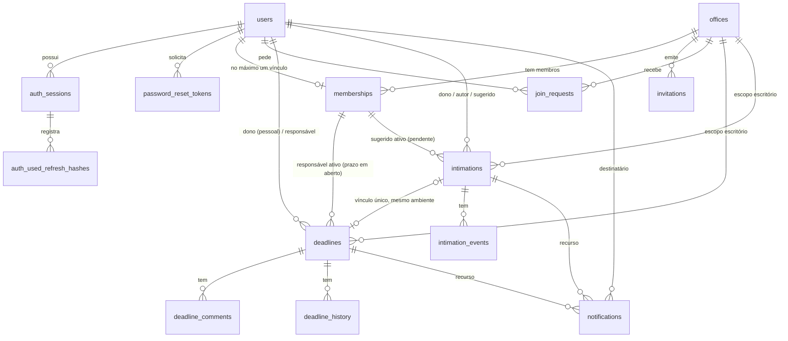

# 15 — Projeto técnico: persistência em PostgreSQL

> **Documento de projeto. Nada aqui foi implementado.** Não há ORM, migrations, dependências
> novas nem mudança de comportamento na aplicação. A implementação só começa após a aprovação das
> decisões da §12.
>
> **Base analisada:** `main` em `d0e182eb0d8bc9ee14e925d97cb9db1ef2fdb9d1` (merge do PR #17,
> Etapa 6.4). **CI pós-merge** (execução por push nesse commit): `frontend`, `backend`,
> "Verificar estrutura" e `integration` (integração real + E2E) com todos os passos em `success`.
> Nenhum bloqueio.
>
> **Arquivo complementar:** `15a-ddl-proposto-postgresql.sql`, um rascunho do esquema validado num
> PostgreSQL 16 descartável (§11). Não é migration.

---

## 1. Fechamento do núcleo funcional

| Funcionalidade | Situação | Observação |
|---|---|---|
| Cadastro, login, sessão, perfil, logout | **Implementado e integrado** | sessão opaca no BFF; tokens só no servidor |
| Escritório, equipe, permissões, convites, solicitações | **Implementado e integrado** | |
| Prazos, calendário, comentários, histórico, transferência | **Implementado e integrado** | vencimento informado pelo usuário (não é cálculo oficial) |
| Intimações (metadados), revisão humana, confirmação, descarte | **Implementado e integrado** | sem arquivo, sem processamento |
| Notificações internas de atribuição | **Implementado e integrado** | não são lembretes de vencimento |
| Recuperação de senha (`forgot`/`reset`) | **Somente no backend** | entrega `NoopPasswordResetDelivery`: nenhum e-mail é enviado; telas `/esqueci-senha` e `/redefinir-senha` mostram "indisponível" |
| `retry` de intimação, pontos de processamento | **Somente no backend** | sem processamento real; rota fora da allowlist do BFF |
| Cálculo legado de prazos e feriados (Etapa 1) | **Somente no backend** | as telas integradas não o usam |
| **Todo o estado do domínio e da autenticação** | **Pendente para o banco** | tudo em memória: perde-se ao reiniciar; um processo só |
| **Dashboard** | **Pendente para o banco** | só existe o protótipo demo; a integração depende de consultas agregadas, mais simples com SQL; não está concluído |
| Retenção e expurgo periódicos | **Pendente para o banco** | hoje são varreduras dentro das transações em memória |
| **Envio de e-mail** (recuperação de senha, convites) | **Pendente para serviços externos** | provedor SMTP/transacional |
| **Armazenamento de PDFs** | **Pendente para serviços externos** | armazenamento de objetos; hoje `file.storage = "not_stored"` |
| **IA/OCR** | **Pendente para serviços externos** | `processing.status = "not_available"` |
| **Sessões do BFF** | **Pendente para produção** | `Map` em memória no processo Node; perde-se ao reiniciar; incompatível com várias instâncias |
| **Limites por processo** (rate limiting) | **Pendente para produção** | `RateLimiter` em memória no backend; com várias instâncias, cada uma conta separado |
| CSP, cookies `__Host-`, HTTPS, segredos, backups, monitoramento, implantação | **Pendente para produção** | a CSP estava prevista para a 6.5 |

---

## 2. Mapeamento do código atual

### 2.1 Interfaces e implementações
| Domínio | Interface (Protocol) | Implementação em memória | Usado por |
|---|---|---|---|
| Usuários e credenciais | `repositories/auth.py: UserRepository` | `repositories/memory.py: InMemoryUserRepository` | `AuthService`, `OrgService` (nomes) |
| Sessões e rotação de refresh | `SessionRepository` (+ `RotationResult`) | `InMemorySessionRepository` | `AuthService.login/refresh/logout` |
| Recuperação de senha | `PasswordResetRepository` | `InMemoryPasswordResetRepository` | `AuthService.forgot/reset` |
| Escritórios, vínculos, convites, solicitações | `repositories/org.py: OrgTransaction`, `OrgRepository` | `repositories/org_memory.py: MemoryOrgStore/MemoryOrgTransaction` | `OrgService` |
| Prazos, comentários, históricos | `repositories/deadlines.py: DeadlineTransaction` | `repositories/deadlines_memory.py` | `DeadlineService`, `deadline_ops.py` |
| Intimações, vínculo, eventos | `repositories/intimations.py: IntimationTransaction` | `repositories/intimations_memory.py` | `IntimationService` |
| Notificações e deduplicação | `NotificationTransaction` (`add` → `False` se duplicada) | `MemoryNotificationTransaction` (chave `destinatário|evento`) | `NotificationService`, `deadline_ops.notify` |
| Transação entre módulos | `repositories/deadlines.py: UnitTransaction` | `repositories/unit_of_work.py: MemoryUnitOfWork` | todos os serviços de domínio |
| Composição | — | `services/auth_container.py`, `services/org_container.py`, `main.py` | criação da app |

### 2.2 Dependências concretas de memória (por que não basta trocar um repositório)
1. **Serviços tipados com a classe concreta:** `DeadlineService`, `IntimationService` e
   `NotificationService` recebem `unit_of_work: MemoryUnitOfWork`. `OrgService` recebe o mesmo
   objeto duas vezes (`repo=uow, unit_of_work=uow`).
2. **Exceção importada do módulo em memória:** `CapacityError` vem de `deadlines_memory.py`
   (usada nos serviços de prazos e intimações).
3. **Locks globais de processo:** `MemoryUnitOfWork.unit()` adquire, em ordem fixa, os locks de
   escritórios, prazos, intimações e notificações. Isso **serializa todas as operações de domínio
   de todos os escritórios**. A troca exige bloqueios por linha (§4).
4. **Invariantes verificados em Python no fim da transação:** `_check_responsibles` e
   `_check_intimations` percorrem os registros tocados (`touched`, `removed_memberships`). No
   PostgreSQL, parte vira restrição e parte vira consulta de verificação (§3.3).
5. **Atomicidade da autenticação por um único `RLock`:** `complete_reset` altera token, usuário e
   sessões de uma vez, por estarem no mesmo `MemoryAuthStore`. No banco, os três repositórios
   precisarão compartilhar **a mesma transação**.
6. **Autenticação e domínio em armazenamentos separados:** `OrgService` lê nomes pelo
   `UserRepository` de outro store. No banco, ficam juntos e permitem junções.
7. **Consultas feitas em memória:** listagens carregam o escopo inteiro (`in_scope`,
   `of_recipient`, `members_of`…) e filtram, ordenam e paginam em Python. No banco, as interfaces
   precisam de métodos de consulta com filtro, ordem e paginação em SQL, com a autorização aplicada
   na consulta.
8. **Limites de capacidade contados em memória:** `validate_capacity` e a política da caixa de
   notificações (`enforce_capacity`) precisam de contagem sob bloqueio.
9. **Expurgo dentro da transação:** `maybe_purge` (convites e solicitações encerrados, intimações
   descartadas, notificações lidas) roda no início das transações.
10. **Relógio lido depois dos locks** (`tx.now`). No banco, o instante é capturado por transação
    depois de obter os bloqueios-âncora; o relógio continua injetável nos testes.
11. **Injeção de falhas:** `fault`/`checkpoint` (5 arquivos de teste). Continua possível: lançar
    uma exceção num checkpoint resulta em `ROLLBACK`.
12. **Configuração e bloqueios:** `AUTH_STORAGE: Literal["memory"]`; `build_*_container` recusa
    memória em `production`.
13. **Testes:** dos 45 arquivos de teste, **30** usam stores, containers ou a unidade de trabalho em
    memória e **12** testam só pela API HTTP.
14. **Fora do backend:** sessões do BFF (`frontend/src/server/bff/session-store.mjs`, `Map`) e
    limitadores (`backend/app/security/rate_limit.py`, por processo).

---

## 3. Modelo PostgreSQL

### 3.1 Diagrama entidade-relacionamento


### 3.2 Tabelas e decisões
O DDL completo está em `15a-ddl-proposto-postgresql.sql`. Resumo das decisões:
- **IDs `uuid`.** Hoje os IDs são `uuid4().hex`. A coluna `uuid` ocupa 16 bytes e já valida o
  formato. A API continua devolvendo os mesmos 32 caracteres hexadecimais (conversão no
  repositório), então os contratos HTTP não mudam. Um ID de rota que não seja hexadecimal vira
  "não encontrado" sem consultar o banco.
- **Instantes × datas civis:** `timestamptz` (gravado em UTC) para `created_at`, `expires_at`,
  `read_at` etc.; `date` para `start_date`, `due_date` e `received_at`; `time` sem fuso para
  `agenda_time`. A urgência continua calculada com `DEADLINES_TIMEZONE`, sem o banco converter
  datas civis.
- **Enumerações:** `text` + `CHECK`, mais simples de evoluir em migrations que tipos `ENUM`.
- **Escopo pessoal/escritório:** `scope_kind` + `owner_id`/`office_id`, com `CHECK` de forma
  (exatamente um preenchido) e a coluna gerada `scope_key`, usada nas FKs compostas.
- **Rascunho da intimação** em colunas tipadas `draft_*` (datas continuam `date`). `suggestion` em
  `jsonb`, reservado.
- **Históricos** (`deadline_history`, `intimation_events`) com `details jsonb`, guardados **sem
  projeção**. A ocultação de referências protegidas continua no serviço, na leitura (como hoje).
  `actor_id NULL` representa o ator "system".
- **Notificações:** colunas `deadline_id`/`intimation_id` com FK e `CHECK` de que exatamente uma
  corresponde a `kind`, no lugar de um `resource_id` sem integridade. `event_id` fica sem FK porque
  vem de duas tabelas de eventos.
- **Índices:** um por listagem real (escopo + status + data), por caixa de notificações e por
  expurgo (parciais, `WHERE`). A busca textual `q` começa com `ILIKE` dentro do escopo, que é
  suficiente para o volume do projeto. `pg_trgm` fica como melhoria, se necessário.

### 3.3 Invariantes e como cada um é garantido
| Invariante | Mecanismo | Como |
|---|---|---|
| E-mail único | **Constraint** | `UNIQUE (email)` + `CHECK (email = lower(email))`; o serviço normaliza; violação → 409 `email_already_registered` |
| Um vínculo por usuário | **Constraint** | `memberships.user_id` é PK |
| Último administrador | **Bloqueio + regra de serviço** | não é expressável como constraint (contagem entre linhas). A operação bloqueia a linha do escritório (`FOR NO KEY UPDATE`), conta administradores e decide (`count_admins` como hoje) |
| Forma do escopo (pessoal ou escritório) | **Constraint** | `CHECK` de exatamente um entre `owner_id`/`office_id`; FKs para `users`/`offices` |
| Isolamento de acesso | **Regra de serviço** | toda consulta filtra por escopo e autorização (`policies/*.py`); o banco não conhece "quem pergunta" (sem RLS nesta fase, ver §12) |
| Prazo pessoal: responsável = dono | **Constraint** | `CHECK (scope_kind = 'office' OR responsible_id = owner_id)` |
| Prazo **em aberto** do escritório com responsável **ativo** | **Constraint (FK diferida)** | `open_office_id` só é preenchida em prazo aberto do escritório (`CHECK`). A FK `(responsible_id, open_office_id) → memberships(user_id, office_id)` é checada no `COMMIT`: remover um vínculo sem reatribuir falha; reatribuir e remover na mesma transação passa |
| Pendência do escritório com sugerido **ativo** | **Constraint (FK diferida)** | mesmo padrão com `suggested_open_office_id` |
| Pendência com responsável **operacional** (autor **ou** sugerido ativo) | **Regra de serviço + consulta de verificação** | disjunção entre linhas: não é FK nem `CHECK`. O serviço garante (como hoje) e, antes do `COMMIT`, uma consulta verifica as pendências tocadas (`ConsistencyError` → `ROLLBACK`) |
| Revisada ⇔ vinculada a prazo | **Constraint** | `CHECK ((status = 'reviewed') = (deadline_id IS NOT NULL))` |
| Vínculo intimação ↔ prazo único | **Constraint** | `intimations.deadline_id UNIQUE` |
| Vínculo no mesmo ambiente | **Constraint (FK diferida)** | `(deadline_id, scope_key) → deadlines(id, scope_key)`; a transferência muda os dois na mesma transação |
| Deduplicação de notificações | **Constraint** | `UNIQUE (recipient_id, event_id)` + `INSERT … ON CONFLICT DO NOTHING` |
| Um token de redefinição ativo por usuário | **Constraint** | índice único parcial `WHERE used_at IS NULL AND invalidated_at IS NULL` (o tempo de expiração não pode entrar no predicado; a emissão invalida o anterior) |
| Uma solicitação pendente por usuário/escritório | **Constraint** | índice único parcial `WHERE status = 'pending'` |
| Versões otimistas | **Transação + regra de serviço** | `SELECT … FOR UPDATE` + comparação da versão (409 `version_conflict` como hoje) e `UPDATE … SET version = version + 1` |
| Limites de capacidade (prazos por escopo, comentários, eventos, caixa) | **Bloqueio + regra de serviço** | contagem sob o bloqueio-âncora do escopo (ou do prazo); caixa de notificações com bloqueio por destinatário (`pg_advisory_xact_lock`) |
| Retenção (convites e solicitações encerrados, intimações descartadas, notificações lidas) | **Regra de serviço (manutenção)** | `DELETE` por índice parcial, em transação curta separada (§5.4); `ON DELETE CASCADE` remove eventos e notificações da intimação expurgada |

---

## 4. Transações e concorrência

### 4.1 Modelo
- **Isolamento `READ COMMITTED`** (padrão do PostgreSQL) + **bloqueios explícitos por linha** +
  restrições. É o que substitui os locks globais: só conflitam operações que tocam o mesmo
  escritório, a mesma pessoa ou o mesmo registro.
- **Uma transação por requisição de escrita**, aberta pela unidade de trabalho SQL (§5.2). Commit
  só ao final; qualquer exceção (regra, capacidade, falha injetada, constraint) → `ROLLBACK`
  integral, cobrindo escritórios, prazos, intimações e notificações juntos (hoje isso é feito com
  cópia na escrita e restauração das referências).
- **Limites de espera:** `lock_timeout` (ex.: 5 s) e `statement_timeout` (ex.: 15 s) por sessão.

### 4.2 Ordem única de bloqueios
1. **Âncoras de escopo:** linha de `offices` (`FOR NO KEY UPDATE`) e depois linhas de `users` dos
   escopos pessoais envolvidos (`FOR NO KEY UPDATE`), em ordem de ID. `NO KEY UPDATE` serializa os
   escritores do mesmo escopo sem bloquear inserções que apenas referenciam a linha por FK.
2. **`memberships`** afetados (em ordem de `user_id`).
3. **`deadlines`** (em ordem de ID).
4. **`intimations`** (em ordem de ID).
5. **Caixas de notificação:** `pg_advisory_xact_lock(hashtextextended('inbox:' || recipient_id, 0))`
   em ordem de destinatário.

Autenticação: **`users` → `password_reset_tokens` → `auth_sessions`**. A autenticação nunca
bloqueia `offices`, e o domínio bloqueia `offices` antes de `users`, então não há ciclo entre as
duas ordens.

### 4.3 Operações críticas
| Operação | Garantia atual (memória) | Substituição no PostgreSQL |
|---|---|---|
| **Login concorrente** e limite de sessões | `RLock` do store | `SELECT … FROM users … FOR NO KEY UPDATE`; confere `credential_version`; remove as sessões excedentes mais antigas; insere a nova. Um `reset` concorrente (que faz `UPDATE` em `users`) espera ou é esperado |
| **Rehash** após login | `update_password_hash_if_version` | `UPDATE users SET password_hash = :h WHERE id = :id AND credential_version = :v` (atômico; 0 linhas = não sobrescreve senha recém-redefinida) |
| **Redefinição de senha** | token, usuário e sessões sob um lock | uma transação: bloqueia `users` → relê o token `FOR UPDATE` e valida → `UPDATE users` (`credential_version + 1`) → invalida os demais tokens → `UPDATE auth_sessions SET revoked_at` |
| **Rotação de refresh** | dicionários de hash atual/usado sob lock | troca atômica: `UPDATE auth_sessions SET current_refresh_hash = :novo, rotation_count = rotation_count + 1 FROM users WHERE current_refresh_hash = :antigo AND revoked_at IS NULL AND expires_at > :agora AND users.id = user_id AND users.credential_version = auth_sessions.credential_version RETURNING …` + `INSERT` do hash antigo em `auth_used_refresh_hashes` |
| **Detecção de reutilização** | hash usado → revoga a família | se o `UPDATE` afetar 0 linhas, procura o hash em `auth_used_refresh_hashes`; se existir e a sessão não tiver expirado → revoga (`REUSED`). Duas rotações simultâneas do mesmo token: a segunda espera o bloqueio da linha, reavalia o `WHERE` (0 linhas) e, como a primeira já confirmou o hash usado, cai em reutilização, como hoje |
| **Confirmar intimação sem duplicar prazo** | lock global + verificação | âncora do escopo → intimação `FOR UPDATE` → versão e estado → regras de criação → `INSERT` do prazo → `UPDATE` da intimação. Uma segunda confirmação espera, vê `reviewed` e devolve 200 `created=false` (ou 409 `already_reviewed`). `UNIQUE(deadline_id)` + `CHECK` impedem duplicação mesmo com erro de código |
| **Reatribuição na saída/remoção** | lock global + checagem final | âncora do escritório → vínculos (alvo e destino) → prazos em aberto e pendências do membro (em ordem de ID) → reatribui → apaga o vínculo. As FKs diferidas recusam o `COMMIT` se sobrar prazo aberto ou sugestão ativa sem vínculo; a regra do responsável operacional é verificada por consulta |
| **Transferência com intimação vinculada** | lock global + checagem do vínculo | âncoras: escritório e usuário dono → prazo `FOR UPDATE` → intimação vinculada `FOR UPDATE` → consentimentos → muda o escopo de ambos. A FK diferida `(deadline_id, scope_key)` garante que os dois mudaram juntos |
| **Rollback integral entre módulos** | cópia na escrita + restauração | uma única transação do PostgreSQL para os quatro módulos; checkpoints de teste lançam exceção → `ROLLBACK` |

### 4.4 Tratamento de conflitos
| Situação | Resposta |
|---|---|
| Versão diferente da enviada | 409 `version_conflict` (como hoje, com `X-Current-Version`) |
| `unique_violation` esperada (e-mail, código de ingresso, solicitação pendente) | mapeada para os códigos atuais (`email_already_registered`, `request_already_pending`…); o código de ingresso tenta outro valor gerado (não é repetição de mutação: é geração de identificador) |
| Violação de FK diferida ou `CHECK` no `COMMIT` | `ConsistencyError` → 500 com log. Indica defeito de código, como hoje |
| `deadlock_detected` (40P01), `lock_not_available` (55P03) | 409 com código novo `concurrent_update`, **sem repetição automática no servidor** (decisão D6) |

### 4.5 Testes necessários (com PostgreSQL real)
- **Contrato dos repositórios:** a mesma suíte roda contra memória e PostgreSQL.
- **Restrições:** os cenários da §11, como testes automatizados.
- **Concorrência real** (duas conexões com barreiras): duas rotações do mesmo refresh; login ×
  reset; dupla confirmação da mesma intimação; remoção de membro × criação de prazo para ele;
  transferência × edição; dois escritores no limite de capacidade; dupla notificação do mesmo
  evento.
- **Rollback:** falha injetada em cada checkpoint existente → nenhum resíduo em nenhuma tabela.
- **Reinício:** criar dados, recriar a aplicação (novo engine) e conferir que tudo persiste,
  inclusive sessões do backend e notificações.
- **Migrations:** `upgrade head` em banco vazio, `downgrade` da última e `upgrade` de novo.

---

## 5. Infraestrutura e plano incremental

### 5.1 Escolhas e compatibilidade
| Item | Escolha | Justificativa |
|---|---|---|
| Driver | `psycopg[binary]==3.3.8` | driver oficial atual do PostgreSQL para Python; síncrono, alinhado aos endpoints atuais (todos `def`, nenhum `async def`) |
| Acesso a dados | `SQLAlchemy==2.1.8`, **Core** (tabelas e SQL explícito), sem ORM declarativo | o domínio usa dataclasses imutáveis; o Core mapeia linha ↔ dataclass com funções explícitas, sem sessões ORM, carregamento implícito ou sincronização automática. Os bloqueios (`with_for_update`) e `ON CONFLICT` ficam visíveis no código |
| Migrations | `alembic==1.20.1` | padrão do ecossistema SQLAlchemy; usa os metadados do Core; migrations revisadas à mão |
| Testes | PostgreSQL 16 real: serviço `postgres:16` no GitHub Actions; localmente, qualquer PostgreSQL apontado por `TEST_DATABASE_URL` | sem testcontainers (evita depender de Docker dentro do pytest) |

As versões foram conferidas num ambiente isolado: instalação sem conflitos com
`fastapi==0.162.0` e `pydantic-settings==2.16.1` (`pip check` limpo) e conexão ao PostgreSQL 16.
A primeira entrega fixa as versões em `requirements.txt`.

### 5.2 Organização proposta (backend)
```
backend/app/db/
├─ engine.py            # create_engine a partir de DATABASE_URL; pool; timeouts por sessão
├─ tables.py            # MetaData + Table (fonte única para Alembic e repositórios)
└─ errors.py            # tradução de erros do psycopg (unique, FK, deadlock) para erros do domínio
backend/app/repositories/sql/
├─ auth.py              # SqlUserRepository, SqlSessionRepository, SqlPasswordResetRepository (mesma conexão)
├─ org.py, deadlines.py, intimations.py, notifications.py   # *Transaction sobre uma Connection
└─ unit_of_work.py      # SqlUnitOfWork: BEGIN, âncoras, checkpoints, verificação final, COMMIT/ROLLBACK
backend/migrations/      # Alembic: env.py, versions/0001_…py
```
- **Serviços** passam a depender de um `UnitOfWork` (Protocol) e de `CapacityError` em
  `app/domain`, não mais de `MemoryUnitOfWork` nem de `deadlines_memory`.
- **Implementação em memória** permanece para testes rápidos e para o modo demo/desenvolvimento
  (decisão D3).
- **Configuração nova:** `STORAGE=memory|postgres` (substitui `AUTH_STORAGE`), `DATABASE_URL`
  (segredo), `DATABASE_POOL_SIZE`, `DATABASE_LOCK_TIMEOUT_MS`, `DATABASE_STATEMENT_TIMEOUT_MS`.
  `production` exige `STORAGE=postgres`.
- **Migrations nunca rodam sozinhas no startup**: comando explícito `alembic upgrade head`. A
  aplicação confere a revisão esperada ao iniciar e recusa subir com esquema desatualizado.

### 5.3 O que fica fora do PostgreSQL (e por quê)
| Estado | Proposta | Motivo |
|---|---|---|
| **Domínio + autenticação do backend** | PostgreSQL | dados de negócio duráveis, com integridade e transações |
| **Sessões do BFF** (tokens do backend, cookies opacos) | permanecem em memória até a decisão de implantação; depois, armazenamento compartilhado com expiração (**Redis** recomendado) | dados efêmeros, com TTL, lidos a cada requisição; ficam no Node, que não deve acessar o banco do domínio; exigiriam cifrar os tokens em repouso |
| **Rate limiting** | por processo até haver várias instâncias; depois, contador compartilhado (Redis, ou tabela simples no PostgreSQL se Redis não for adotado) | contadores de janela curta e alta frequência; não são dados de negócio |

### 5.4 Retenção
Função de manutenção (`app/maintenance.py`) com `DELETE … WHERE <retenção>` em transações curtas e
em lotes. Ela é chamada de forma oportunista no máximo uma vez por intervalo por processo (como o
`maybe_purge` atual) e também por um comando (`python -m app.maintenance purge`), para agendamento
futuro. A política da caixa (limite por destinatário) continua dentro da transação que cria a
notificação, sob o bloqueio da caixa.

### 5.5 Sequência de entregas
| # | Entrega | Critérios de aprovação |
|---|---|---|
| **P1** | **Fundação:** dependências fixadas, `DATABASE_URL`, engine, `app/db/`, Alembic com `0001` (esquema vazio), serviço PostgreSQL no CI, fixture de banco de teste | app inalterada com `STORAGE=memory` (padrão); 607 testes + frontend + integração + E2E verdes; `alembic upgrade head`/`downgrade base` no CI |
| **P2** | **Esquema:** migration `0002` com as tabelas aprovadas; testes de restrições (os cenários da §11) | migrations aplicam e revertem; testes de restrição verdes; nenhum serviço usa o banco ainda |
| **P3** | **Autenticação no PostgreSQL:** repositórios SQL de usuários, sessões, hashes usados e redefinição; `STORAGE=postgres` | contrato dos repositórios verde em memória e PostgreSQL; concorrência (rotação dupla, login × reset, rehash × reset); reinício preserva usuários e sessões |
| **P4** | **Domínio no PostgreSQL:** `SqlUnitOfWork` + escritórios, prazos, intimações e notificações; consultas paginadas em SQL; serviços desacoplados da memória | suíte de serviços e API verde também com PostgreSQL; checkpoints com rollback integral; testes de concorrência da §4.5; integração e E2E com PostgreSQL no CI |
| **P5** | **Manutenção e operação:** retenção, verificação de revisão do esquema no startup, documentação de operação (backup e restauração em desenvolvimento) | expurgo testado com relógio controlado; startup recusa esquema desatualizado |
| Depois | Sessões do BFF e rate limiting compartilhados; e-mail; armazenamento de PDFs; IA/OCR | projetos próprios, após decisões de implantação |

Cada entrega preserva todos os testes existentes. A implementação em memória continua sendo a
referência de comportamento até o PostgreSQL passar na mesma suíte.

---

## 6. Mapa de arquivos atuais → componentes futuros
| Atual | Futuro |
|---|---|
| `repositories/auth.py` (Protocols) | mantido; implementações SQL em `repositories/sql/auth.py` |
| `repositories/memory.py` (`MemoryAuthStore` e repositórios) | mantido para testes e demo |
| `repositories/org.py`, `deadlines.py`, `intimations.py` (Protocols) | mantidos, com **métodos de consulta paginada** novos |
| `repositories/*_memory.py`, `memory_tx.py`, `unit_of_work.py` | mantidos para testes e demo; `CapacityError` e `ConsistencyError` passam para `app/domain` |
| — | `app/db/{engine,tables,errors}.py`, `repositories/sql/*`, `migrations/` |
| `services/auth_container.py`, `services/org_container.py` | escolhem memória ou SQL por `STORAGE`; montam o engine uma vez por app |
| `services/*_service.py` | dependem do Protocol `UnitOfWork`; regras inalteradas |
| `core/config.py` | `STORAGE`, `DATABASE_URL`, pool e timeouts |
| `security/rate_limit.py` | inalterado nesta fase (por processo) |
| `frontend/src/server/bff/session-store.mjs` | inalterado nesta fase |

---

## 7. Exemplo explicado: "confirmar intimação → transação → prazo"
Uma pessoa confirma a intimação `I` (versão 3) do escritório `E`, criando um prazo para a
responsável `R`.
```sql
BEGIN;                                                      -- READ COMMITTED
SELECT id FROM offices WHERE id = :E FOR NO KEY UPDATE;     -- 1. âncora: um escritor por vez neste escritório
SELECT * FROM memberships WHERE user_id IN (:ator, :R);     -- 2. vínculo e permissões ATUAIS (protegidos pela âncora)
SELECT * FROM intimations WHERE id = :I FOR UPDATE;         -- 3. trava a intimação
--    serviço: versão = 3? status = awaiting_review? regras de criação e delegação? (senão 409/403/422 → ROLLBACK)
SELECT count(*) FROM deadlines WHERE office_id = :E;        -- 4. limite de prazos do escopo
INSERT INTO deadlines (..., responsible_id, status, open_office_id, version) VALUES (..., :R, 'open', :E, 1);
INSERT INTO deadline_history (...) VALUES (..., 'created', '{"source": {"intimationId": ":I"}}');
UPDATE intimations SET status = 'reviewed', deadline_id = :D, closed_at = :agora, version = 4
 WHERE id = :I AND version = 3;                             -- 5. vínculo + versão otimista
INSERT INTO intimation_events (...) VALUES (..., 'confirmed', ...);
SELECT pg_advisory_xact_lock(hashtextextended('inbox:' || :R, 0));       -- 6. caixa de R
INSERT INTO notifications (...) VALUES (...) ON CONFLICT (recipient_id, event_id) DO NOTHING;
--    serviço: aplica o limite da caixa de R (remove as lidas mais antigas, se necessário)
COMMIT;                                                     -- 7. FKs diferidas: R tem vínculo ativo? prazo e intimação no mesmo ambiente?
```
- **Se algo falhar em qualquer passo:** `ROLLBACK`; nem o prazo, nem o histórico, nem a
  notificação existem.
- **Se outra pessoa confirmar ao mesmo tempo:** ela espera no passo 1 ou 3; ao continuar, vê
  `reviewed` e recebe 200 `created=false` (ou 409 `already_reviewed`, sem o ID).
- **Se R for removida do escritório nesse meio-tempo:** a remoção também usa a âncora do passo 1,
  então uma das duas operações espera a outra. Se, por defeito de código, o prazo ficasse com
  responsável sem vínculo, a FK diferida recusaria o `COMMIT`.

---

## 8. Glossário
- **Tabela:** estrutura com colunas tipadas (por exemplo, `deadlines`); cada linha é um registro.
- **Chave primária (PK):** coluna que identifica cada linha de forma única (`id`).
- **Chave estrangeira (FK):** coluna que precisa apontar para uma linha existente de outra tabela
  (`deadlines.responsible_id → users.id`). **Diferida** = conferida só no `COMMIT`, permitindo
  passos intermediários na mesma transação.
- **Restrição (constraint):** regra que o banco recusa violar (`UNIQUE`, `CHECK`, `FOREIGN KEY`).
- **Índice:** estrutura que acelera buscas e ordenações por certas colunas. **Parcial** = só para
  as linhas que atendem a uma condição (ex.: só não lidas).
- **Migration:** script versionado que altera o esquema do banco de forma reproduzível (`upgrade`
  e `downgrade`), aplicado pelo Alembic.
- **Transação:** conjunto de operações que é confirmado inteiro (`COMMIT`) ou desfeito inteiro
  (`ROLLBACK`).
- **Bloqueio (lock):** reserva de uma linha para que outra transação espere (`SELECT … FOR UPDATE`).
- **Versão otimista:** número que muda a cada alteração; quem envia uma versão antiga recebe
  conflito em vez de sobrescrever.

---

## 9. Riscos e limitações
- **Escopo da P4:** a unidade de trabalho cobre quatro módulos ao mesmo tempo, então não dá para
  migrar um módulo por vez sem perder a atomicidade. Mitigação: entrega única com subcommits e a
  suíte atual como rede de proteção.
- **Duas implementações (memória e SQL)** precisam ser mantidas iguais. Mitigação: testes de
  contrato comuns.
- **Consultas e paginação no SQL:** risco de divergir das regras de autorização aplicadas hoje em
  Python. Mitigação: a autorização entra na própria consulta, com os mesmos casos de teste.
- **Serialização por escritório** (âncora): operações do mesmo escritório entram em fila, como
  hoje (que é global). É adequado ao volume do projeto; não é desenho para alta concorrência.
- **Sem RLS:** o isolamento de acesso continua sendo regra do serviço, e um erro de consulta pode
  vazar dados. Mitigação: testes de isolamento já existentes, executados também com PostgreSQL.
- **Fusos:** o servidor do banco não decide datas civis; a urgência continua calculada na
  aplicação.
- **Fora do escopo desta persistência:** sessões do BFF, rate limiting compartilhado, e-mail, PDFs,
  IA/OCR, dashboard, implantação.

---

## 10. Roteiro curto para apresentação (Lucas)
1. **Hoje:** tudo em memória, o que traz perda ao reiniciar, um processo só e operações em fila
   única.
2. **Proposta:** PostgreSQL para dados de negócio; sessões do BFF e limites de taxa tratados à
   parte.
3. **Diagrama ER:** usuários, escritórios e vínculos; prazos e intimações com o vínculo único;
   notificações.
4. **Integridade no banco:** e-mail único, um escritório por pessoa, responsável ativo (FK
   diferida), vínculo único e no mesmo ambiente, notificação sem duplicar.
5. **Transação de exemplo:** confirmar intimação → prazo (§7).
6. **Plano:** P1 a P5, cada um com critérios e testes em banco real.

---

## 11. Validação do rascunho do esquema (executada nesta análise)
O DDL de `15a-ddl-proposto-postgresql.sql` foi aplicado num **PostgreSQL 16.15 descartável**,
criado e removido neste ambiente de análise (não faz parte do projeto; nenhum banco existente foi
tocado). As 14 tabelas foram criadas sem erros. Cenários executados:

| # | Cenário | Esperado | Obtido |
|---|---|---|---|
| 1–2 | e-mail duplicado; e-mail com maiúsculas | falha | `users_email_key`; `users_email_check` |
| 3 | segundo vínculo do mesmo usuário | falha | `memberships_pkey` |
| 4 | prazo aberto do escritório com responsável sem vínculo | falha no `COMMIT` | `deadlines_active_responsible_fk` |
| 5 | prazo aberto para membro ativo | passa | ok |
| 6 | remover vínculo com prazo aberto, sem reatribuir | falha no `COMMIT` | `deadlines_active_responsible_fk` |
| 7 | `open_office_id` incoerente com o status | falha | `CHECK` |
| 8 | reatribuir e remover o vínculo na mesma transação | passa | ok |
| 9–10 | prazo pessoal com responsável ≠ dono; vencimento antes do início | falha | `CHECK` |
| 11 | intimação pessoal revisada vinculada ao prazo pessoal | passa | ok |
| 12 | segunda intimação para o mesmo prazo | falha | `intimations_deadline_id_key` |
| 13 | revisada sem vínculo | falha | `CHECK` |
| 14 | transferir só o prazo | falha no `COMMIT` | `intimations_deadline_same_scope_fk` |
| 15 | transferir prazo e intimação juntos | passa | ok |
| 16 | pendência sugerida a quem não tem vínculo | falha no `COMMIT` | `intimations_suggested_active_fk` |
| 17 | notificação duplicada com `ON CONFLICT DO NOTHING` | 1 inserida, depois 0 | ok |
| 18 | dois tokens de redefinição ativos | falha | `password_reset_one_active_per_user` |
| 19 | permissão desconhecida | falha | `memberships_permissions_check` |
| 20 | `UPDATE` com versão antiga | 0 linhas | ok (versão atual preservada) |

Também foi conferido: **SQLAlchemy 2.1.8 + Alembic 1.20.1 + psycopg 3.3.8** instalam sem
conflitos com as dependências atuais e executam `SELECT … FOR UPDATE` no PostgreSQL 16.

---

## 12. Decisões que precisam de aprovação
| # | Decisão | Proposta |
|---|---|---|
| D1 | Stack de acesso a dados | SQLAlchemy 2.1 **Core** (sem ORM declarativo) + Alembic + psycopg 3 síncrono |
| D2 | Tipo dos IDs | `uuid` no banco, mantendo o hex de 32 caracteres na API |
| D3 | Implementação em memória | manter para testes rápidos e demo; produção exige PostgreSQL |
| D4 | Garantias no banco | FKs diferidas para "responsável/sugerido ativo" e "vínculo no mesmo ambiente"; responsável operacional e último administrador por serviço + bloqueio |
| D5 | Concorrência | `READ COMMITTED` + âncora por escritório ou pessoa (`FOR NO KEY UPDATE`) + ordem única de bloqueios |
| D6 | Conflitos de bloqueio | 409 `concurrent_update` (código novo), **sem repetição automática no servidor** |
| D7 | Sessões do BFF e rate limiting | fora do PostgreSQL nesta fase; armazenamento compartilhado (Redis recomendado) quando houver implantação com várias instâncias |
| D8 | Retenção | função de manutenção oportunista + comando explícito; sem agendador nesta fase |
| D9 | Testes com banco real | serviço `postgres:16` no CI e `TEST_DATABASE_URL` local; sem testcontainers |
| D10 | Migrations | só por comando explícito; a app verifica a revisão ao iniciar |
| D11 | Sequência | P1 → P5 conforme §5.5, cada entrega com auditoria |
