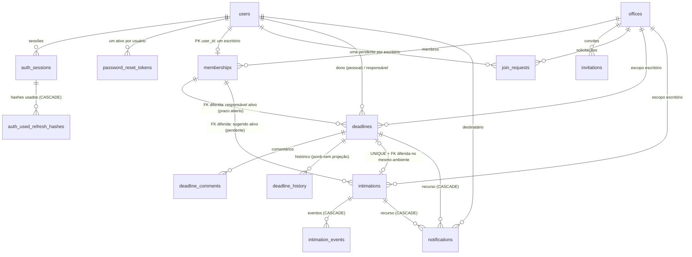

# 17 — P2: esquema PostgreSQL

> **Base:** `main` `d90538a1ebfdd1281290d374c5b5696309a3bef6` (merge do PR #18, P1). CI pós-merge
> verde: todos os passos de `frontend`, `backend`, "Verificar estrutura" e `integration` com
> `success`. Branch: `feature/persistence-p2`.
>
> **Escopo:** somente o esquema. Foram criadas as 14 tabelas aprovadas
> (`15-projeto-persistencia-postgresql.md`), com SQLAlchemy Core e migration `0002`. **Nenhum
> serviço usa o banco**, `STORAGE` continua aceitando só `memory`, produção continua bloqueada e o
> frontend e os contratos HTTP não mudaram.

## 1. Mapa dos arquivos
```
backend/app/db/
├─ metadata.py                 # MetaData ÚNICO (esquema "prazoai", convenção de nomes) — P1
└─ tables/                     # P2: definições Core por domínio; importar o pacote registra as 14 tabelas
   ├─ __init__.py              # ponto ÚNICO de importação (+ TABLE_NAMES); a aplicação web NÃO o importa
   ├─ _types.py                # uuid, timestamptz, colunas de escopo, scope_key gerada
   ├─ identity.py              # users, auth_sessions, auth_used_refresh_hashes, password_reset_tokens
   ├─ org.py                   # offices, memberships, invitations, join_requests
   ├─ deadlines.py             # deadlines, deadline_comments, deadline_history
   ├─ intimations.py           # intimations, intimation_events
   └─ notifications.py         # notifications
backend/migrations/
├─ env.py                      # passa a usar app.db.tables (comparação com o esquema migrado)
└─ versions/
   ├─ 0001_fundacao.py         # INALTERADA (vazia)
   └─ 0002_esquema_inicial.py  # DDL explícito das 14 tabelas; downgrade só delas, com RESTRICT
backend/tests/
├─ conftest.py                 # + pg_schema (banco em head, tabelas vazias); pg_clean limpa só o que existe
├─ pg_support.py               # TRUNCATE qualificado com RESTRICT, agora com as 14 tabelas
├─ test_db_schema.py           # 22 cenários + COMMIT real, rollback, índices parciais, inspeção, comparação
├─ test_db_postgres.py         # migrations: vazio→head, 0001→0002, 0002→0001→0002, base→head, externos
└─ test_db_foundation.py       # sem banco: 0001 intacta, 0002 independente, app não importa as tabelas
.github/workflows/ci.yml       # ciclo de migrations pela linha de comando até 0002 (E2E inalterado)
```

## 2. Diagrama


## 3. Principais relações
- **Escopo:** prazos, intimações e notificações têm `scope_kind` + `owner_id` ou `office_id`
  (exatamente um, por `CHECK`). `deadlines` e `intimations` têm a coluna **gerada** `scope_key`
  (`personal:<id>` ou `office:<id>`), usada na FK composta que exige o mesmo ambiente.
- **Responsável ativo:** `open_office_id` só é preenchida em prazo **aberto** do escritório
  (`CHECK`). A FK diferida `(responsible_id, open_office_id) → memberships(user_id, office_id)` faz
  o `COMMIT` falhar se o responsável não tiver vínculo atual. O mesmo padrão vale para
  `suggested_open_office_id` nas intimações pendentes.
- **Intimação ↔ prazo:** `deadline_id UNIQUE`, `CHECK (revisada ⇔ vinculada)` e a FK diferida
  `(deadline_id, scope_key) → deadlines(id, scope_key)`. A transferência muda os dois na mesma
  transação.
- **Notificações:** colunas `deadline_id`/`intimation_id` com FK e `CHECK` que exige exatamente a
  coluna correspondente a `kind`; deduplicação por `UNIQUE (recipient_id, event_id)`.
- **Históricos:** `details jsonb` guardado **sem projeção**; a ocultação de referências protegidas
  continua no serviço. `actor_id NULL` representa o "sistema".

## 4. Regra → mecanismo → teste
| Regra | Mecanismo | Teste (`tests/…`) |
|---|---|---|
| E-mail normalizado único | `uq_users_email` + `ck_users_email_normalized` | `test_db_schema::test_01`, `test_02` |
| Um vínculo por usuário | `pk_memberships` (PK em `user_id`) | `test_03` |
| Forma do escopo | `ck_{deadlines,intimations,notifications}_scope_shape` | `test_forma_do_escopo_e_recurso_da_notificacao` |
| Responsável pessoal = dono | `ck_deadlines_personal_responsible_is_owner` | `test_09` |
| Vencimento ≥ início | `ck_deadlines_due_after_start` | `test_10` |
| Responsável ativo de prazo aberto do escritório | `fk_deadlines_active_responsible` (**diferida**) + `ck_deadlines_open_office_matches_status` | `test_04` e `test_06` (falham no COMMIT real), `test_05`, `test_07`, `test_08` |
| Sugerido ativo de pendência do escritório | `fk_intimations_suggested_active` (**diferida**) + `ck_intimations_suggested_open_office_matches` | `test_16` (COMMIT real) |
| Vínculo único intimação ↔ prazo | `uq_intimations_deadline_id` (vários `NULL` permitidos) | `test_12`, `test_varios_opcionais_nulos…` |
| Vínculo no mesmo ambiente | `fk_intimations_deadline_same_scope` (**diferida**) | `test_14` (COMMIT real), `test_15` |
| Revisada ⇔ vinculada; encerrada ⇔ terminal | `ck_intimations_reviewed_iff_linked`, `ck_intimations_closed_iff_terminal` | `test_13`, `test_coerencia_de_convite_e_de_encerramento` |
| Convite: encerrado ⇔ não pendente | `ck_invitations_closed_iff_not_pending` | `test_coerencia_de_convite…` |
| Uma solicitação pendente por usuário e escritório | índice único parcial `uq_join_requests_one_pending` | `test_solicitacao_pendente_unica_e_liberada_apos_decisao` |
| Um token de recuperação ativo | índice único parcial `uq_password_reset_tokens_one_active_per_user` | `test_18_19`, `test_token_liberado_apos_uso_ou_invalidacao` |
| Deduplicação de notificações | `uq_notifications_recipient_id_event_id` + `ON CONFLICT DO NOTHING` | `test_17` |
| Permissões conhecidas | `ck_memberships_permissions_known` | `test_20` |
| Versão otimista | `ck_*_version_positive` + `UPDATE … WHERE version = :v` (**serviço**) | `test_21` |
| Código de ingresso único, nova tentativa sem abortar | `uq_offices_join_code` + `ON CONFLICT DO NOTHING` (**serviço**) | `test_22` |
| Rollback sem registros parciais | transação | `test_rollback_integral_sem_registros_parciais` |
| Datas civis e instantes | `date`/`time`/`timestamptz` | `test_tipos_civis_e_instantes_preservados` |
| Histórico de hashes some com a sessão | `ON DELETE CASCADE` | `test_sessao_apagada_leva_o_historico_de_hashes` |
| **Último administrador** | **serviço futuro** (bloqueio da âncora + contagem, P4) | — (planejado) |
| **Responsável operacional** (autor **ou** sugerido ativo) | **serviço futuro** + consulta de verificação (P4) | — (planejado) |
| **Autorização e isolamento de acesso** | **serviço** (consultas filtradas, P3/P4) | — (planejado) |
| **Dupla confirmação sem segundo prazo** | **serviço futuro**: bloqueio + revalidação + transação (P4); as constraints garantem só a forma do vínculo | — (planejado) |

Inspeção: `test_constraints_com_nomes_estaveis` (conjunto exato por tabela),
`test_indices_com_nomes_estaveis_e_parciais`, `test_fks_diferidas_e_imediatas`,
`test_tipos_das_colunas`, `test_tabelas_no_esquema_explicito_e_nada_em_public`.
**Comparação:** `test_esquema_migrado_igual_ao_metadata`, com a prova negativa
`test_comparacao_detecta_divergencia`.

## 5. Decisões e observações
- **Nomes explícitos:** no rascunho (`15a`), alguns `CHECK` tinham nomes automáticos
  (`deadlines_check1`…). Na P2, todos têm nomes estáveis (`ck_deadlines_due_after_start`…). O
  conteúdo das regras não mudou. O script `15b` continua válido para o rascunho, não para o esquema
  migrado; os mesmos cenários agora estão em `test_db_schema.py`.
- **Migration explícita:** a `0002` é SQL qualificado (`prazoai.<tabela>`) e não importa a
  aplicação. O teste de comparação garante que `app/db/tables` corresponde ao que a migration cria.
- **Ações dos eventos de intimação:** sem `CHECK`, como no projeto aprovado (o código emite 8 ações
  hoje; ações de processamento futuras não exigirão migration).
- **Notificações de intimação expurgada:** a FK com `ON DELETE CASCADE` remove a notificação quando
  a intimação descartada for apagada pela retenção (P5). Hoje, em memória, a notificação ficaria
  oculta.
- **Conformidade com o domínio atual:** alfabeto do código de ingresso, estados, limites de texto e
  arquivo, `decided_at` no cancelamento e os tipos do rascunho foram conferidos. Nenhuma
  incompatibilidade foi encontrada.

## 6. Comandos seguros
```bash
cd backend
# banco DESCARTÁVEL de desenvolvimento
export DATABASE_URL=postgresql+psycopg://prazoai:<senha>@localhost:5432/prazoai_dev
python -m app.db check
alembic upgrade head            # 0001 → 0002 (14 tabelas)
alembic current                 # 0002 (head)
alembic downgrade 0001          # remove só as 14 tabelas (o esquema e objetos externos ficam)
alembic upgrade head

# testes com PostgreSQL real (banco de teste separado, prazoai_test*, local)
ENVIRONMENT=test TEST_DATABASE_URL=postgresql+psycopg://prazoai:<senha>@localhost:5432/prazoai_test pytest
```
Nunca aponte esses comandos para um banco com dados reais. A fixture de testes recusa bancos não
autorizados antes de escrever, mas os comandos `alembic` usam a `DATABASE_URL` que você indicar.

## 7. Limitações
- Nenhum repositório SQL: a aplicação continua 100% em memória (`STORAGE=memory`).
- As regras de serviço (último administrador, responsável operacional, autorização, dupla
  confirmação, capacidades, retenção) chegam com as transações da P3/P4/P5.
- A normalização do e-mail é feita pela aplicação (`.lower()` do Python). O `CHECK
  email = lower(email)` usa o `lower()` do banco, que pode diferir do Python em casos raros de
  Unicode, conforme a collation.
- Sem dados reais nem seeds: as tabelas nascem vazias.

## 8. Roteiro de apresentação (Lucas, cerca de 5 minutos)
1. **Onde estamos (30 s):** "A P1 preparou conexão e migrations. A P2 cria as tabelas, mas a
   aplicação continua em memória; quem usa o banco agora são só os testes."
2. **Organização (45 s):** mostrar `app/db/tables/` por domínio, com um `MetaData` só e um ponto de
   importação. A migration `0002` é SQL explícito com nomes estáveis.
3. **Diagrama (1 min):** usuários, escritórios e vínculos; prazos e intimações com o vínculo único;
   notificações.
4. **A ideia mais interessante (1 min 15 s):** "responsável ativo" com FK diferida.
   - `open_office_id` só existe em prazo aberto do escritório, e a FK aponta para o vínculo atual;
   - remover a pessoa sem reatribuir faz o `COMMIT` falhar;
   - reatribuir e remover na mesma transação passa (`test_06` × `test_08`).
5. **Transferência (45 s):** prazo e intimação mudam juntos; mudar só o prazo falha no `COMMIT`
   (`test_14` × `test_15`).
6. **Qualidade (45 s):** os 22 cenários viraram testes com PostgreSQL 16 real; a inspeção confere
   os nomes de constraints e índices; a comparação prova que migration e código descrevem o mesmo
   esquema, inclusive detectando divergências.
7. **Limites (30 s):** "Constraints não substituem regras de serviço: último administrador,
   responsável operacional, autorização e dupla confirmação vêm com as transações das próximas
   etapas."
